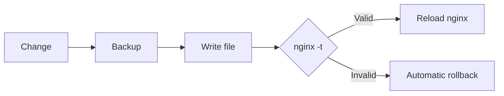

The first release of **Roastgate** is out: a self-hosted web UI that drives the nginx already installed on your server. Your `/etc/nginx` stays the source of truth.

<!-- truncate -->

## What is Roastgate?

[Roastgate](https://github.com/ByteRoast/Roastgate) is a web UI that runs in a Docker container next to your nginx. It manages **reverse proxies**, **hosted sites**, **IP whitelists** and **Let's Encrypt certificates**, without ever leaving nginx's own files.

No custom format, no hidden database of configs: Roastgate reads and writes the regular nginx files (`conf.d/`, `sites-available/`, `sites-enabled/`). You can keep editing them by hand, and stop using Roastgate at any time. Your files stay where they are.

:::warning Alpha
Roastgate is in its `0.x` alpha releases: settings, the database schema and the behaviour can change between versions. Keep a backup of the data volume before each update.
:::

## What it manages

| Area | Content | Activation |
|---|---|---|
| `conf.d/` | reverse proxies | `.conf` and `.conf.disabled` |
| `sites-available/` | hosted sites | symlink in `sites-enabled/` |
| `whitelists/<name>.conf` | `allow <ip>;` lines | included from your configs |

### A safe change cycle

Every change follows the same cycle:



Writes are atomic (temporary file, then rename) and keep the original file permissions. The 30 most recent backups of each file are kept, and the **Backups** page lets you compare any version with the current file and restore it.

## Features

### Creation wizard

Describe a reverse proxy or a static site in a form and Roastgate writes the nginx config: WebSockets, HTTPS with an optional redirect, HTTP/2, HSTS, upload limit, timeouts, security headers, whitelists, the Let's Encrypt challenge, and free directives for anything else. A preview tab shows exactly what will be written.

- **Safe by construction**: every value is validated against a strict pattern before it reaches the file.
- **Aware of your nginx**: HTTP/2 is written as `http2 on;` from nginx 1.25.1, and as `listen ... ssl http2;` before.
- **Reopenable**: the settings are stored in a comment at the top of the generated file, so reopening it restores the form. If you edited the file by hand, the wizard tells you before replacing your changes.

### Importing hand-written configs

Already have configs? Open one in the wizard and its settings are **read from the file**: names, ports, upstream, certificate, whitelists, upload limit, WebSocket headers, timeouts, redirect. Anything the form has no field for is kept as free directives, so nothing is lost.

When a file can't be reproduced faithfully (a top-level `upstream`, a regex `server_name`, more than two server blocks...), it is refused with the reason and stays editable as raw text.

### Raw editing

Every file can be edited in a [Monaco editor](https://github.com/microsoft/monaco-editor) with nginx syntax highlighting. Enabling or disabling a proxy or a site is a single switch.

### Let's Encrypt certificates

Get, list, renew and delete certificates from the **Certificates** page.

- Use the **embedded certbot** (shipped in the image, renewed twice a day by Roastgate) or the one **installed on the host**.
- Certificates are read from the files certbot maintains: domains, issuer, expiry, and which of your configs use them.
- nginx is reloaded only when a certificate really changed.
- A **dry run** validates your domains against Let's Encrypt's staging server first.
- A certificate still used by a config cannot be deleted.

:::info
Wildcard certificates need a DNS challenge and are not supported.
:::

### IP whitelists

- A list editor with strict validation of IPv4, IPv6 and CIDR ranges (`10.0.0.5/24`, which nginx silently ignores, is flagged).
- Paste many addresses at once, or add the one you are connecting from in one click.
- Each whitelist shows **where it is used**, and one that is still included cannot be deleted.

## Security

Roastgate controls your web server: whoever controls Roastgate is, in practice, root on the host. So security got a lot of attention for this first release.

- **Two-factor authentication** (TOTP) with any authenticator app, and ten single-use recovery codes.
- **Passkeys**: sign in with a fingerprint, face, device PIN or a security key, on their own or as the second step. Once a passkey exists, the password alone is no longer enough.
- **Rate limiting**: 5 failures per 15 minutes per client address.
- **Session revocation**: changing the password ends every open session, on every device.
- **Audit log** of every sign-in and failure.

:::danger Keep it private
Keep the port on `127.0.0.1` and reach it through an SSH tunnel, a VPN, or an nginx server block protected by a whitelist and HTTPS.
:::

## How can I get Roastgate?

### Requirements

- A Linux server with **nginx installed on the host** (Debian and Ubuntu layouts are supported)
- **Docker** with the Compose plugin
- Optional: `certbot` on the host

### Install

You only need the compose file, not the whole repository. In a folder of your choice:

```bash
mkdir roastgate && cd roastgate
curl -fsSL -o docker-compose.yml https://raw.githubusercontent.com/ByteRoast/Roastgate/refs/heads/main/docker-compose.yml
docker compose up -d
docker logs roastgate        # prints the setup token
```

Or with PowerShell (`pwsh`):

```powershell
New-Item -ItemType Directory roastgate | Set-Location
Invoke-WebRequest -Uri https://raw.githubusercontent.com/ByteRoast/Roastgate/refs/heads/main/docker-compose.yml -OutFile docker-compose.yml
docker compose up -d
docker logs roastgate        # prints the setup token
```

The image is published on `ghcr.io/byteroast/roastgate`. To stay on this version, use the `0.1.0` tag instead of `latest` in `docker-compose.yml`.

### Build from source

To build the image yourself, clone the repository and build it there:

```bash
git clone https://github.com/ByteRoast/Roastgate.git
cd Roastgate
docker compose up -d --build
```

### Development image

Want the latest changes first? `docker-compose.dev.yml` is the same compose file, pinned on the `dev` image, which follows every push to the `dev` branch. Download it **as `docker-compose.yml`** and every other command stays the same:

```bash
curl -fsSL -o docker-compose.yml https://raw.githubusercontent.com/ByteRoast/Roastgate/refs/heads/dev/docker-compose.dev.yml
docker compose pull
docker compose up -d
```

```powershell
Invoke-WebRequest -Uri https://raw.githubusercontent.com/ByteRoast/Roastgate/refs/heads/dev/docker-compose.dev.yml -OutFile docker-compose.yml
docker compose pull
docker compose up -d
```

:::warning Unstable
The `dev` image gets the changes first and can break. Both files use the same container and the same `roastgate-data` volume, so switching keeps your account. But going back from `dev` to `latest` is not guaranteed to work: `dev` may already have upgraded the database to a schema that `latest` does not know. **Back up the volume before you try `dev`.**
:::

### First start

Open `http://127.0.0.1:8181` (from your own machine, `ssh -L 8181:127.0.0.1:8181 user@server` gives you that address) and follow the setup:

1. Enter the **setup token** from the logs
2. Create the **administrator** account
3. Choose the **paths and options** (nginx directory, whitelists directory, ACME webroot, certbot mode)
4. Review the **host diagnostics**
5. Done: you are signed in automatically

### Update

From the folder that holds `docker-compose.yml`:

```bash
docker compose pull
docker compose up -d
```

Download the compose file again (same `curl` or `Invoke-WebRequest` command as above) only when the release notes say it changed. It overwrites your copy, so redo your own edits afterwards (ports, mounts, setup token…). If you built from source: `git pull`, then `docker compose up -d --build`.

### Back up your data

The database lives in the `roastgate-data` volume, so your account and backups survive updates and `docker compose down`. Only `docker compose down --volumes` (or `docker volume rm roastgate-data`) deletes it. To back it up:

```bash
docker run --rm -v roastgate-data:/data -v "$PWD":/backup alpine tar czf /backup/roastgate-data.tgz -C /data .
```

### Locked out?

Forgot the password:

```bash
docker exec -it roastgate roastgate reset-password
```

Lost your authenticator app, the recovery codes and the passkeys:

```bash
docker exec roastgate roastgate disable-2fa
```

This turns two-factor off, removes every passkey and ends every session, so the password alone signs you in again.

### Uninstall

```bash
docker compose down            # keeps the data volume
docker compose down --volumes  # also deletes the account, settings and backup history
```

Then delete the folder that holds `docker-compose.yml`, and the image with `docker image rm ghcr.io/byteroast/roastgate:latest` (or the tag you used). Your nginx files stay where they are: Roastgate never moves them.

## Technical details

Roastgate is built with [.NET 10](https://github.com/dotnet/core) and [MudBlazor](https://github.com/MudBlazor/MudBlazor), with [BlazorMonaco](https://github.com/serdarciplak/BlazorMonaco) for the editor. Data is stored in SQLite.

The container runs `privileged` with `pid: host`, so it can run `nginx` and `certbot` in the host namespaces through `nsenter`. Commands are never run through a shell.

## Contributing

Bug reports, ideas, documentation fixes and code are all welcome. Roastgate is in alpha and maintained on a best-effort basis, so answers may take a few days.

- **Found a bug or want a feature?** Open an issue using the [issue forms](https://github.com/ByteRoast/Roastgate/issues/new/choose). For anything bigger than a small fix, wait for a reply before writing code.
- **Want to contribute code?** Fork the repository, branch from **`dev`** and open your pull request **against `dev`**, not `main`. The [Contributing Guide](https://github.com/ByteRoast/Roastgate/blob/main/CONTRIBUTING.md) covers the code style, tests, commits and the contributor license agreement.

:::danger Found a vulnerability?
Do not open a public issue. Report it privately through [GitHub's private vulnerability reporting](https://github.com/ByteRoast/Roastgate/security/advisories/new), as described in the [security policy](https://github.com/ByteRoast/Roastgate/blob/main/SECURITY.md). Only the latest release and the `dev` image receive security fixes.
:::

## License

Roastgate is free and open source under the **AGPL-3.0-or-later** license.

---

- [Roastgate on GitHub](https://github.com/ByteRoast/Roastgate)
- [Release 0.1.0](https://github.com/ByteRoast/Roastgate/releases/tag/v0.1.0)
- [Report issues](https://github.com/ByteRoast/Roastgate/issues)
