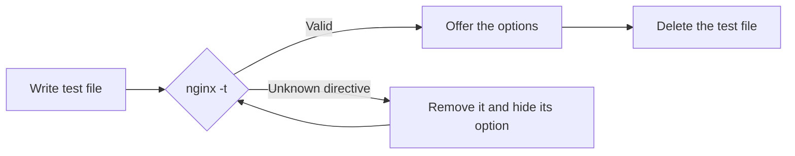

**Roastgate 0.3.0** is out: static sites can now show a browsable directory listing, and Roastgate checks what your nginx really supports before offering it.

{/* truncate */}

## Browsable directory listings

A site can now list the files of its folders, with sizes and dates, instead of answering a 403 when a folder has no `index.html`. Handy for a download area, a mirror or a folder of build artifacts.

The listing uses the [fancyindex](https://github.com/aperezdc/ngx-fancyindex) module of nginx. Turn on **Browsable directory listing (fancyindex)** in the **Essentials** tab of the site wizard, and pick its options:

- **Sort**: by name, size or date, ascending or descending, with directories first or not.
- **Display**: exact or rounded sizes, local time or UTC, your own time format, the path above the listing.
- **Hiding**: dotfiles, symlinks, the parent directory link, and a list of names to leave out.
- **Theme**: your own header, footer and CSS files.

As always, the preview tab shows exactly what will be written. A listing sorted by date, newest first:

```nginx
location / {
    try_files $uri $uri/ =404;
    fancyindex on;
    fancyindex_exact_size on;
    fancyindex_localtime off;
    fancyindex_show_path on;
    fancyindex_directories_first on;
    fancyindex_show_dotfiles off;
    fancyindex_hide_symlinks off;
    fancyindex_hide_parent_dir off;
    fancyindex_default_sort date_desc;
    fancyindex_time_format "%Y-%b-%d %H:%M";
}
```

A few safeguards come with it:

- **Show dotfiles** is refused while **Block TRACE and dotfiles** is on, since that protection refuses every path that starts with a dot.
- A theme kept in a dot folder (such as `/.nginxy/`) is let through the dotfile protection: only the folders of your header, footer and CSS files, nothing else.
- The header, footer and CSS paths and the time format are validated before they reach the file.

Existing `fancyindex` directives are also read back when you [import a hand-written config](/docs/roastgate/reverse-proxies-and-sites#importing-a-hand-written-config) into the wizard.

## Aware of your nginx modules

fancyindex is not part of nginx itself. Roastgate now reads the modules your nginx loads (`nginx -T`), and only offers the listing when fancyindex is one of them. When it is missing, the switch is greyed out and the wizard tells you what to install:

```bash
sudo apt install libnginx-mod-http-fancyindex
sudo systemctl reload nginx
```

### Builds of a module differ

Even when the module is loaded, not every build knows every directive. Ubuntu's `libnginx-mod-http-fancyindex` 0.5.2, for instance, has no `fancyindex_case_sensitive`, and nginx refuses a whole file that names a directive it does not know.

Guessing from a version number is not reliable, so Roastgate asks nginx itself. It writes a small test configuration in `/etc/nginx/.roastgate-probe`, with your `load_module` lines and the optional directives, runs `nginx -t` on it, and deletes it right after:



Your configuration is never touched. An option nginx does not know is hidden from the wizard, and when nginx cannot be asked at all, the option stays available and `nginx -t` keeps the last word at save time.

:::info
The answers of nginx are kept for five minutes. After installing another build of a module, wait five minutes or restart Roastgate.
:::

The [documentation](/docs/roastgate/reverse-proxies-and-sites#directory-listing) covers every option.

## For contributors

Every file of the code base now declares a single top-level type, a rule now written in the [Contributing Guide](https://github.com/ByteRoast/Roastgate/blob/main/CONTRIBUTING.md). Nothing changes for users, but finding your way in the code is easier.

The full documentation also moved from the README to [this website](/docs/roastgate/): the README now keeps the essentials and links to it.

## How can I get Roastgate 0.3.0?

### Update

From the folder that holds `docker-compose.yml`:

```bash
docker compose pull
docker compose up -d
```

The compose file did not change in this release: there is no need to download it again.

:::warning[Alpha]
Roastgate is still in its `0.x` alpha releases. Back up the `roastgate-data` volume before updating:

```bash
docker run --rm -v roastgate-data:/data -v "$PWD":/backup alpine tar czf /backup/roastgate-data.tgz -C /data .
```
:::

To stay on this version, use the `0.3.0` tag instead of `latest` in `docker-compose.yml`.

### New installation

Follow the [installation guide](/docs/roastgate/installation), or the [Introducing Roastgate 0.1.0](/blog/roastgate-0.1.0#how-can-i-get-roastgate) post: the steps are the same.

---

- [Roastgate on GitHub](https://github.com/ByteRoast/Roastgate)
- [Release 0.3.0](https://github.com/ByteRoast/Roastgate/releases/tag/v0.3.0)
- [Report issues](https://github.com/ByteRoast/Roastgate/issues)
