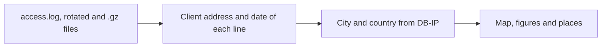

**Roastgate 0.4.0** is out: a new **Traffic** page shows where the requests to your server come from, on a world map, and the result of an action now shows as a toast next to where you are working.

{/* truncate */}

## Where your traffic comes from

The new **Traffic** page, in the menu between **Audit log** and **Settings**, reads the nginx access logs and places each request on a world map:



- **A period** to choose: the last hour, 24 hours, 7 days, 30 days, or since a date.
- **Key figures**: requests, distinct addresses, countries, and the requests that could not be located (private addresses, your own Docker network…).
- **The map**: countries shaded by their number of requests, on a logarithmic scale so that one busy country does not wash out the others, and a point for each city. Hover a country or a city to see its flag and its numbers. Zoom, pan, and open it in full screen.
- **The places**: the top ten cities with a bar each, and a paginated table of all of them.

Roastgate reads the current `access.log`, the rotated files and the `.gz` archives, in nginx's default `combined` format. Files last written before the chosen period are skipped without being opened, so a short period stays fast even with months of archives. Nothing is stored: the page reads the logs again each time.

### The GeoIP database

Addresses are located with [DB-IP City Lite](https://db-ip.com/db/download/ip-to-city-lite), a free database released each month under CC BY 4.0. It is not shipped in the image. To let Roastgate download it and keep it up to date, set one variable in `docker-compose.yml`:

```yaml
environment:
  ROASTGATE_GEOIP_AUTO_UPDATE: "true"
```

Five minutes after startup, then once a day, Roastgate checks whether a newer monthly database is out. It downloads it (about 60 MB), checks that the file is valid, and swaps it in without a restart. You can also copy the file by hand.

The [documentation](/docs/roastgate/traffic) covers the page, the logs that are read, and the database.

:::caution[Behind a CDN or a proxy]
The map shows the address nginx logs as the client. Behind a CDN, that is the CDN, unless nginx's [`real_ip` module](https://nginx.org/en/docs/http/ngx_http_realip_module.html) is set up.
:::

## Action results as toasts

Saving a file, enabling a site, restoring a backup or running certbot used to show its result as an alert at the top of the page. It could be far from the button you clicked, and it stayed there long after it stopped being useful.

A success now shows as a short **toast** at the top of the screen, naming the file: `app.example.com.conf: Saved. nginx reloaded.` It disappears after five seconds.

What you need to read stays on the page:

- a **failure or a warning** stays inline, with the output of `nginx -t` or certbot, so you can read it while fixing the problem;
- **alerts about a state** (nginx not reachable, a missing directory, a file edited by hand…) and form errors do not change.

Deleting a file from its editor now also tells you it is done: the toast shows on the list you are taken back to. If nginx could not be reloaded, that toast is a warning that stays until you close it.

## For contributors

The end-to-end suite, which drives the real interface against a real nginx, moved from a single JavaScript file to **TypeScript** modules run by Node directly, with **pnpm** scripts to build the images and start a fresh container. It now lives in `tests/Roastgate.E2E`, is part of the solution, and takes a screenshot of every section. Its [README](https://github.com/ByteRoast/Roastgate/blob/main/tests/Roastgate.E2E/README.md) explains how to run it and how to add a check.

## How can I get Roastgate 0.4.0?

### Update

The compose file changed in this release: it mounts the nginx logs, read-only, for the Traffic page. Either [download it again](/docs/roastgate/installation#install), which overwrites your own edits, or add the mount to your copy:

```yaml
volumes:
  - /var/log/nginx:/var/log/nginx:ro
```

Then, from the folder that holds `docker-compose.yml`:

```bash
docker compose pull
docker compose up -d
```

:::warning[Alpha]
Roastgate is still in its `0.x` alpha releases. Back up the `roastgate-data` volume before updating:

```bash
docker run --rm -v roastgate-data:/data -v "$PWD":/backup alpine tar czf /backup/roastgate-data.tgz -C /data .
```

:::

To stay on this version, use the `0.4.0` tag instead of `latest` in `docker-compose.yml`.

### New installation

Follow the [installation guide](/docs/roastgate/installation), or the [Introducing Roastgate 0.1.0](/blog/roastgate-0.1.0#how-can-i-get-roastgate) post: the steps are the same.

---

- [Roastgate on GitHub](https://github.com/ByteRoast/Roastgate)
- [Release 0.4.0](https://github.com/ByteRoast/Roastgate/releases/tag/v0.4.0)
- [Report issues](https://github.com/ByteRoast/Roastgate/issues)
