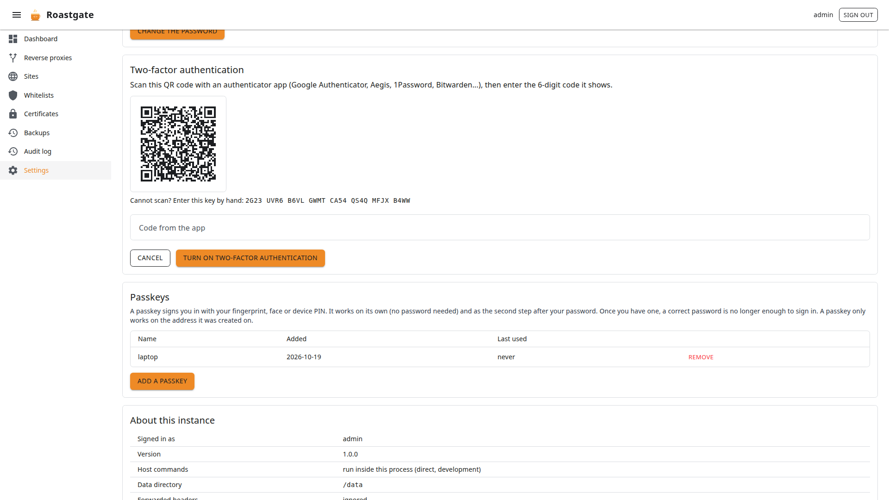
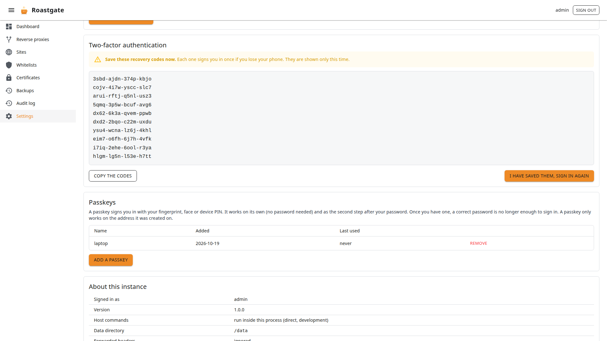
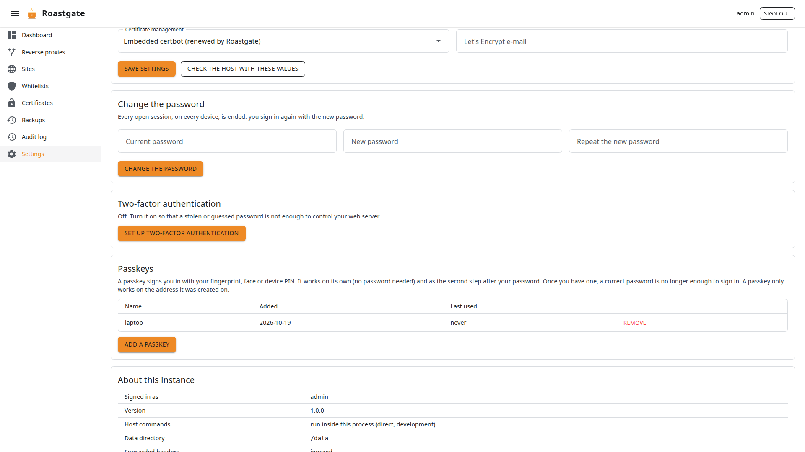

# Account and security

Roastgate controls your web server, and its container is privileged with `pid: host`: **whoever controls Roastgate is, in practice, root on the host.** Protect it accordingly.

## Password

Use a long, unique password. It is changed from **Settings → Change the password** (the current password is required).

**Changing the password ends every open session**, on every device, within 30 seconds. It is also the answer to a stolen session.

Forgot it? See [Reset the password](./maintenance.md#forgot-the-password).

## Two-factor authentication

In **Settings → Two-factor authentication**, click **Set up two-factor authentication**.



1. Scan the QR code with an authenticator app ([Aegis](https://github.com/beemdevelopment/Aegis), [Google Authenticator](https://support.google.com/accounts/answer/1066447), [1Password](https://1password.com), [Bitwarden](https://bitwarden.com)…). Cannot scan? Type the key shown below it.
2. Enter the 6-digit code shown by the app and click **Turn on two-factor authentication**.
3. **Save the ten recovery codes** now: they are shown only once. Each one signs you in once if you lose your phone.



Sign-in then has two steps: the code is asked only after a correct password.

- A code can be used only once, and one step of clock drift (30 s) is tolerated.
- Five wrong codes end the attempt, and the client address is locked out after five failures.
- **Get new recovery codes** replaces the old ones (confirm with a code from the app).
- **Turn it off** needs your password and a code (or a recovery code).

Turning two-factor on or off ends every session, this one included: you sign in again with the new step.

## Passkeys

A passkey signs you in with a fingerprint, your face, a device PIN or a security key. In **Settings → Passkeys**, click **Add a passkey**, give it a name (`laptop`, `phone`…), confirm with your password and follow your browser.



A passkey works in two ways:

- **On its own**: click **Sign in with a passkey** on the sign-in page, no password needed.
- **As the second step**, after the password, in place of the authentication code.

:::warning[Once a passkey exists, the password alone is not enough]
After the password, Roastgate always asks for a passkey (or a code, if two-factor is on).
:::

- A passkey only works on the **address it was created on**: `127.0.0.1`, or the domain of your HTTPS server block. Browsers only allow passkeys on `localhost` / `127.0.0.1` or over HTTPS, so a plain `http://` domain does not work.
- The list shows when each passkey was added and last used.
- **Remove** asks for your password and ends every open session.

Lost your phone, the recovery codes and the passkeys? See [Locked out of two-factor](./maintenance.md#locked-out-of-two-factor).

## Reach Roastgate through nginx

By default Roastgate is only reachable through an SSH tunnel. To open it in a browser without one, put it behind your nginx — with Roastgate itself:

1. Create a [whitelist](./whitelists.md) with your own addresses.
2. Create a [reverse proxy](./reverse-proxies-and-sites.md#the-creation-wizard), for example `roastgate.example.com`:
   - **Forward to**: `http://127.0.0.1:8181`
   - **Support WebSockets**: on (the interface needs them)
   - **Access**: tick your whitelist
   - **Let the Let's Encrypt validation through**: on
3. [Get a certificate](./certificates.md#get-a-certificate) for the domain, then reopen the proxy and turn on **HTTPS** and **Redirect HTTP to HTTPS**.
4. In `docker-compose.yml`, enable both variables and restart with `docker compose up -d`:

```yaml
    environment:
      ROASTGATE_SECURE_COOKIES: "true"
      ROASTGATE_TRUST_FORWARDED_HEADERS: "true"
```

Keep the port mapping on `127.0.0.1:8181`: then only your nginx can send the forwarded headers, and the sign-in throttle and whitelists see your real address.

:::danger
Never enable `ROASTGATE_TRUST_FORWARDED_HEADERS` if port `8181` can be reached directly by others: they could fake their address.
:::

## Sessions and data

- The session cookie is `HttpOnly` and `SameSite=Strict`, and `Secure` with `ROASTGATE_SECURE_COOKIES=true`.
- Open browser tabs are rechecked every 30 seconds, so an ended session stops quickly.
- The `/data` volume holds the database **and the keys that encrypt session cookies**. On Linux these keys are stored unencrypted: keep the volume readable by root only.

## Reporting a vulnerability

Do not open a public issue. Report it privately through [GitHub's private vulnerability reporting](https://github.com/ByteRoast/Roastgate/security/advisories/new), as described in the [security policy](https://github.com/ByteRoast/Roastgate/blob/main/SECURITY.md).
