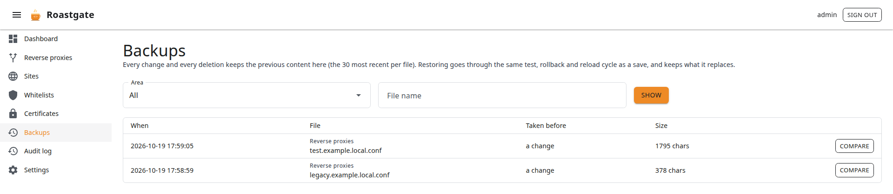
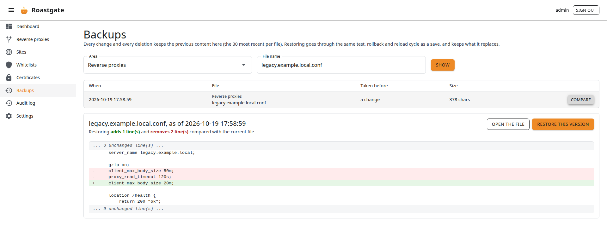
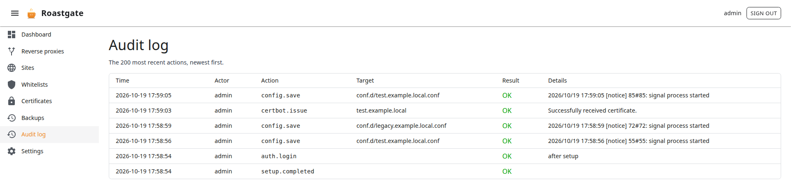

# Backups and audit log

## Backups

Every overwrite and every deletion made from Roastgate keeps the previous content of the file, in Roastgate's database. The **30 most recent backups of each file** are kept.

A change that nginx refused leaves no backup behind, since it would only repeat the current file.

Open **Backups** from the menu, or from the **history** link of any file. Filter by **Area** (reverse proxies, sites, whitelists) and **File name**, then click **Show**.

Each backup shows when it was taken, the file, what change it was taken before, and its size.

### Compare and restore

Click **Compare** to see the version next to the current file, line by line: what restoring would **add** and **remove**.

- If the file was deleted since, restoring creates it again.
- If the version is identical to the current file, restoring changes nothing.

Click **Restore this version**. A restore goes through the same cycle as a save: backup of the current file, write, `nginx -t`, rollback if invalid, reload if valid. So a restore can itself be undone.

## Audit log

The **Audit log** page lists the 200 most recent actions, newest first: time, actor, action, target, result and details.

It records sign-ins and failures, password, two-factor and passkey changes, settings changes, every change to your files (save, enable, disable, delete, restore), nginx tests and reloads, and certificate operations.
