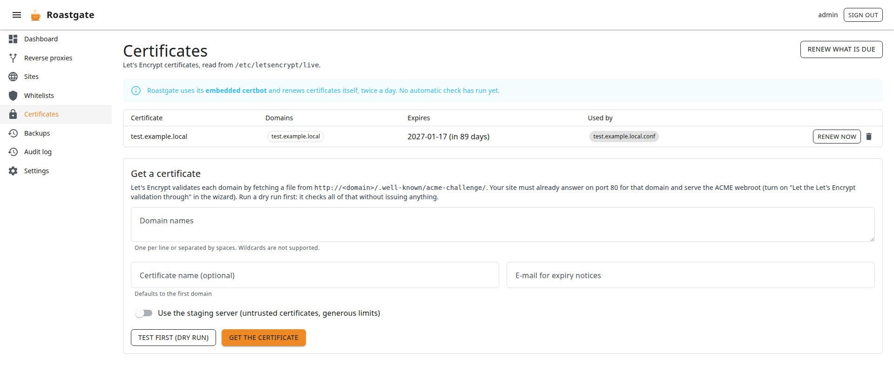

# Certificates

The **Certificates** page manages Let's Encrypt certificates with certbot. The certificates are read from the files certbot maintains (`/etc/letsencrypt/live` by default), not from its text output.

## Certificate modes

The mode is chosen during the [setup](./first-start.md#3-paths-and-options) and can be changed in the [settings](./settings-and-configuration.md):

| Mode                              | Who runs certbot                                       | Who renews                                     |
|-----------------------------------|--------------------------------------------------------|------------------------------------------------|
| **Embedded certbot**              | the certbot shipped in the Roastgate image             | Roastgate, twice a day                         |
| **certbot installed on the host** | the host's certbot, driven through `nsenter`           | the host's own certbot timer                   |
| **Do not manage certificates**    | nobody: Roastgate only lists what it finds             | —                                              |

In embedded mode, the page shows the time and result of the last automatic check.

:::warning[Only one renewer]
If you use the embedded certbot while certbot is also installed on the host, disable the host's certbot timer, or switch to host mode. The setup diagnostics warn you about it.
:::

## The list

Each certificate shows its name, domains, expiry date and **which configs use it** (a disabled config is marked). Certificates from the staging server are flagged: browsers do not trust them.

- **Renew now**: renews this certificate, even if it is not due yet.
- **Renew what is due** (top of the page): renews every certificate close to its expiry.
- **Delete**: deletes the certificate. A certificate still used by a config **cannot be deleted**.

nginx is reloaded only when a certificate really changed (the file is compared before and after), so it never keeps serving an old one. A failed reload is reported.

## Get a certificate

Let's Encrypt validates each domain by fetching a file from `http://<domain>/.well-known/acme-challenge/`. Before you start:

1. The domain points to your server (DNS `A` / `AAAA` records).
2. nginx answers on port **80** for that domain.
3. That server block serves the ACME webroot: tick **Let the Let's Encrypt validation through** in the [wizard](./reverse-proxies-and-sites.md#https).

Then fill in the **Get a certificate** form:

- **Domain names**: one per line or separated by spaces.
- **Certificate name** (optional): defaults to the first domain.
- **E-mail for expiry notices**: defaults to the one in the settings.
- **Use the staging server**: untrusted certificates, with generous rate limits. Useful for tests.

Click **Test first (dry run)**: it checks everything against Let's Encrypt's staging server without issuing anything. When it passes, click **Get the certificate**.

Then use the certificate in the **HTTPS** tab of the wizard: pick it in **Use a Let's Encrypt certificate** and the paths are filled in.

:::info
Wildcard certificates (`*.example.com`) need a DNS challenge and are not supported.
:::
