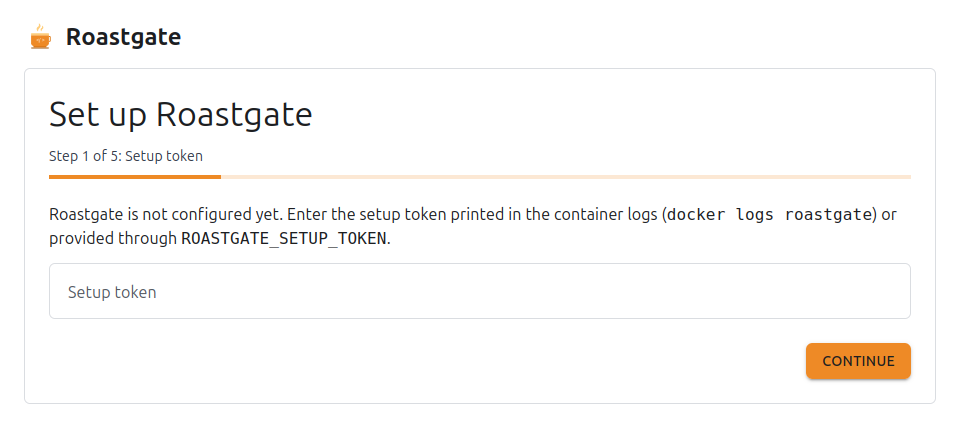
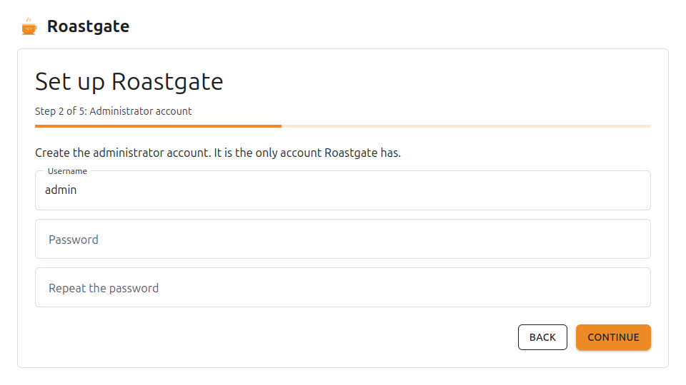
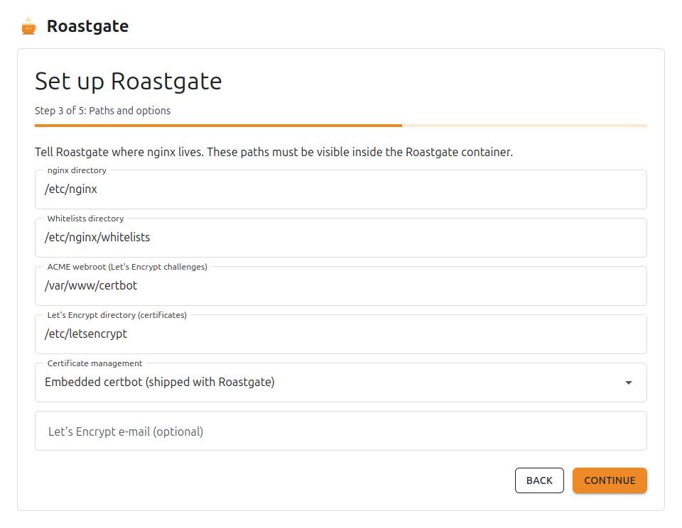
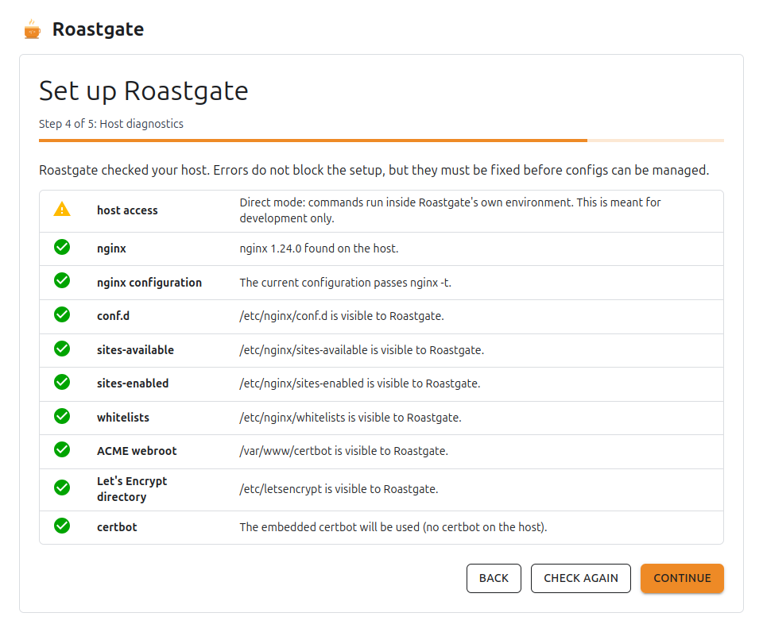
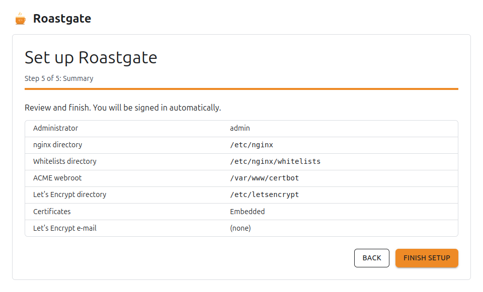
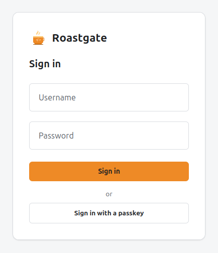

# First start

## The setup wizard

The first visit to Roastgate opens `/setup`. It has five steps.

### 1. Setup token

Enter the token printed by `docker logs roastgate` (or the one you set in `ROASTGATE_SETUP_TOKEN`). It proves that you have access to the server.

### 2. Administrator account

Create the administrator: it is the **only account** Roastgate has.

- **Username**: 3 to 32 characters, lowercase letters, digits, dots, hyphens or underscores.
- **Password**: at least 12 characters, with at least 3 of: lowercase letters, uppercase letters, digits, symbols. A passphrase of 20 characters or more needs no mix. It must not contain the username or be too repetitive.

The problems are listed below the field while you type.

### 3. Paths and options

Tell Roastgate where nginx lives. These are the paths **inside the container**: with the provided compose file, they are the same as on the host.

| Field                                  | Default                 |
|----------------------------------------|-------------------------|
| nginx directory                        | `/etc/nginx`            |
| Whitelists directory                   | `/etc/nginx/whitelists` |
| ACME webroot (Let's Encrypt challenges) | `/var/www/certbot`      |
| Let's Encrypt directory (certificates) | `/etc/letsencrypt`      |
| Certificate management                 | Embedded certbot        |
| Let's Encrypt e-mail (optional)        | none                    |

**Certificate management** has three choices:

- **Embedded certbot**: the one shipped with Roastgate. Roastgate renews the certificates itself, twice a day.
- **certbot installed on the host**: Roastgate drives it, and the host's own certbot timer renews the certificates.
- **Do not manage certificates**: Roastgate only lists the certificates it finds.

:::tip
If certbot is already installed on the host and renews your certificates, pick **certbot installed on the host**. Never let both renew at the same time.
:::

### 4. Host diagnostics

Roastgate checks the host with the values you entered:

| Check                   | What it means                                                                          |
|-------------------------|----------------------------------------------------------------------------------------|
| host access             | commands can run in the host namespaces (needs `privileged: true` and `pid: host`)     |
| nginx                   | nginx was found, and its version                                                       |
| nginx configuration     | the current configuration passes `nginx -t`                                            |
| conf.d, sites-available, sites-enabled | the directories are visible to Roastgate                                |
| whitelists              | the whitelists directory exists (created with the first whitelist otherwise)           |
| ACME webroot            | the webroot exists (certificates cannot be issued without it)                          |
| Let's Encrypt directory | the certificates directory is visible                                                  |
| certbot                 | the certificate mode can work, and warns if two certbots could renew at once           |

Errors do not block the setup, but they must be fixed before configs can be managed. Fix the compose file or the paths, then **Check again**.

### 5. Finish

Review the summary and click **Finish setup**. You are signed in automatically, and `/setup` no longer exists.

## Signing in

Sign in with your username and password, or with a [passkey](./account-security.md#passkeys). When two-factor authentication or a passkey is set up, a second step asks for a code or the passkey.

Sign-in is rate limited: after 5 failures in 15 minutes, the client address is locked out for a while. Every sign-in and failure is written to the [audit log](./backups-and-audit-log.md#audit-log).

## The dashboard

The dashboard shows whether nginx is reachable, and its version. Three buttons act on nginx directly:

- **Check again**: probes nginx again.
- **Test configuration**: runs `nginx -t` and shows its output.
- **Reload nginx**: reloads nginx (after a successful `nginx -t`).

The **Runtime** card shows how host commands are run (`Nsenter` in production, `Direct` in a development or test container) and where the data lives.

The menu on the left leads to every area: **Reverse proxies**, **Sites**, **Whitelists**, **Certificates**, **Backups**, **Audit log** and **Settings**.
