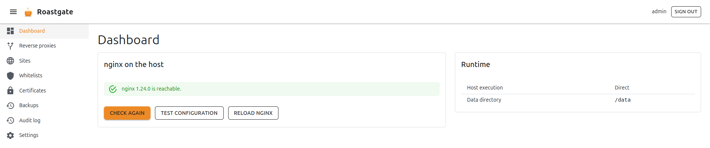
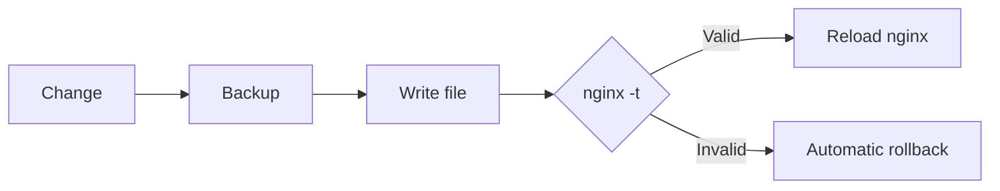

# Roastgate

Roastgate is a web UI that drives the **nginx installed on your server**. It runs in a Docker container next to nginx and manages:

- **Reverse proxies**: forward a domain to an application or a container.
- **Sites**: serve static files (a website, a single page application).
- **IP whitelists**: restrict a proxy or a site to some addresses.
- **Let's Encrypt certificates**: get, renew and delete them.

Roastgate never uses a format of its own: it reads and writes the regular nginx files. Your `/etc/nginx` stays the source of truth, so you can keep editing the files by hand, and stop using Roastgate at any time without losing anything.

:::warning Alpha
Roastgate is in its `0.x` alpha releases: settings, the database schema and the behaviour can change between versions. [Back up the data volume](./maintenance.md#back-up-the-data) before each update.
:::

## What it manages

| Area                     | Content             | Where                        | Enabled when                                     |
|--------------------------|---------------------|------------------------------|--------------------------------------------------|
| Reverse proxies          | `server` blocks     | `conf.d/<name>.conf`         | the file ends with `.conf` (not `.conf.disabled`) |
| Sites                    | `server` blocks     | `sites-available/<name>`     | a symlink exists in `sites-enabled/`             |
| Whitelists               | `allow <ip>;` lines | `whitelists/<name>.conf`     | a config `include`s it                           |
| Certificates             | Let's Encrypt       | `/etc/letsencrypt`           | a config points at it                            |

Debian and Ubuntu layouts (`conf.d/`, `sites-available/`, `sites-enabled/`) are supported.

## A safe change cycle

Every change made from Roastgate (save, enable, disable, delete, restore) follows the same cycle:

- The previous content is kept as a **backup** (the 30 most recent per file), see [Backups](./backups-and-audit-log.md).
- Writes are **atomic** (temporary file, then rename) and keep the original file permissions.
- If `nginx -t` fails, the change is **undone** and the nginx error is shown. nginx keeps running with the previous configuration.
- If `nginx -t` was already failing for a reason unrelated to your change, the change is undone too, and Roastgate tells you so.

## Where to start

1. [Install Roastgate](./installation.md) on your server.
2. Run the [first setup](./first-start.md).
3. Create your first [reverse proxy or site](./reverse-proxies-and-sites.md).
4. Protect your account with [two-factor authentication or a passkey](./account-security.md).
