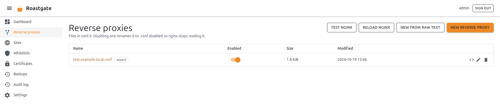
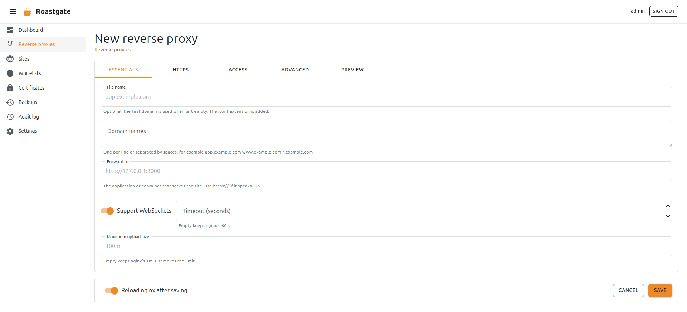
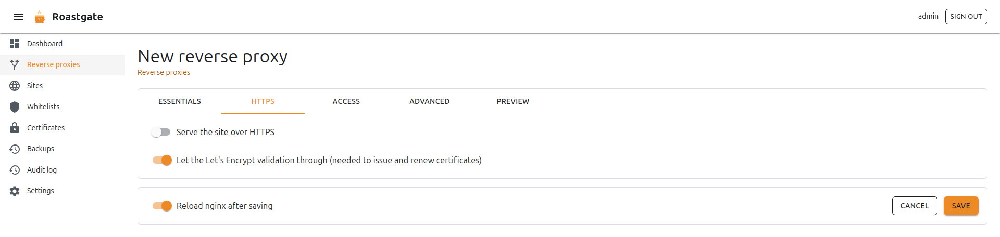
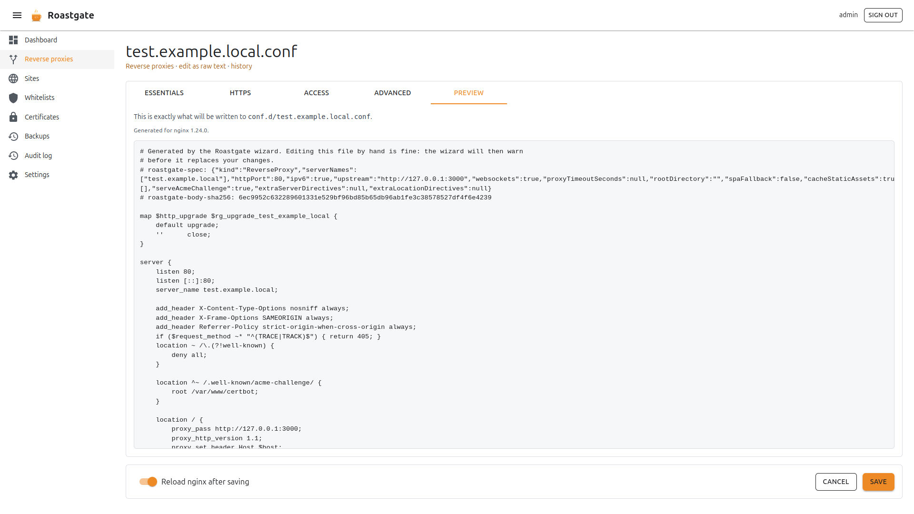
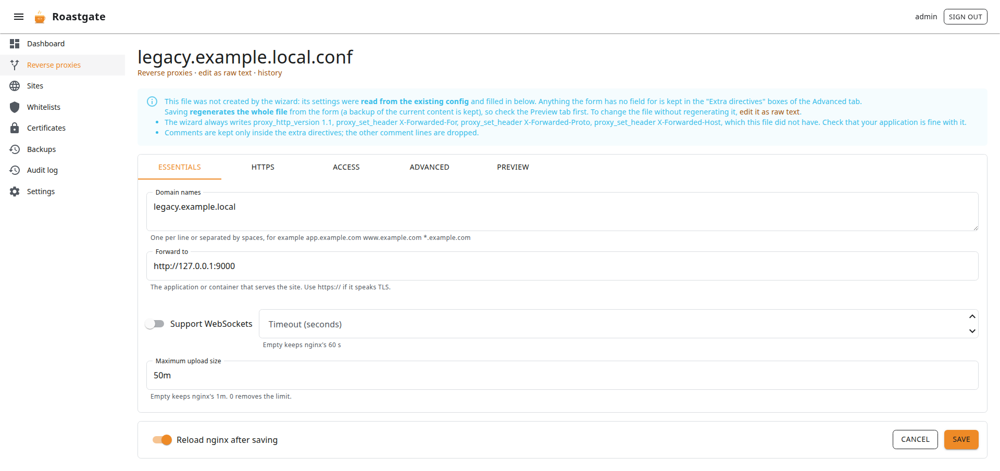
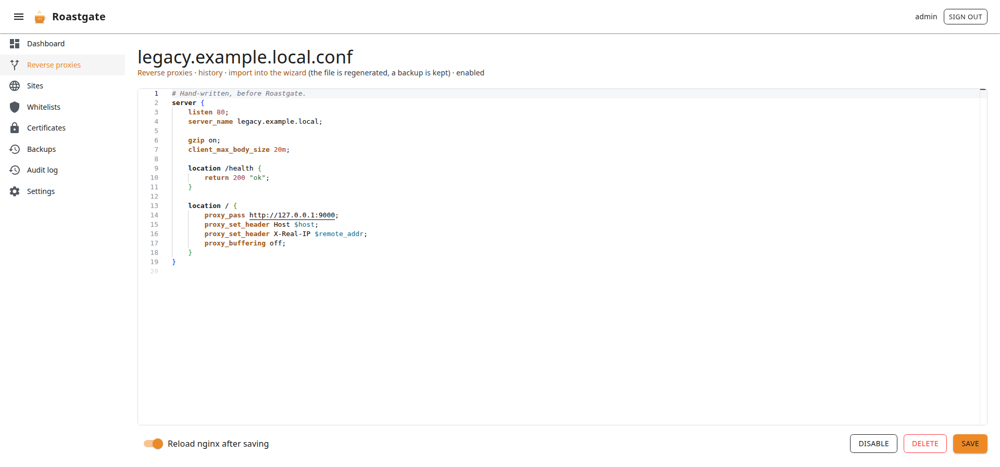

# Reverse proxies and sites

Both pages work the same way. They only differ by what they hold and how a file is enabled:

| Page                | Holds                                         | Files              | Disabling…                                         |
|---------------------|-----------------------------------------------|--------------------|----------------------------------------------------|
| **Reverse proxies** | domains forwarded to an application           | `conf.d/*.conf`    | renames the file to `.conf.disabled`               |
| **Sites**           | static files served by nginx                  | `sites-available/` | removes the symlink in `sites-enabled/`            |

## The list

Each row shows the file name, an **Enabled** switch, its size and its last change. Files created by the wizard carry a **wizard** chip.

- **Enabled** switch: enables or disables the file in one click. For sites, Roastgate only touches symlinks that point at the site itself, relative or absolute (the Debian default site uses an absolute one).
- ✏️ **Edit**: opens the file in the wizard if the wizard created it, in the raw editor otherwise.
- `</>` **Edit as raw text** (wizard files only): opens the raw editor instead of the form.
- 🗑️ **Delete**: deletes the file after a confirmation. A backup is kept.

The buttons at the top:

- **Test nginx**: runs `nginx -t`.
- **Reload nginx**: tests, then reloads nginx.
- **New from raw text**: creates a file in the raw editor.
- **New reverse proxy** / **New site**: opens the creation wizard.

## The creation wizard

Describe the proxy or the site in a form and Roastgate writes the nginx configuration. The form has five tabs.

### Essentials

| Field                       | Reverse proxy | Site | Notes                                                                                     |
|-----------------------------|:-------------:|:----:|-------------------------------------------------------------------------------------------|
| File name                   | ✓             | ✓    | Optional: the first domain is used when left empty. Proxies get the `.conf` extension.    |
| Domain names                | ✓             | ✓    | One per line or separated by spaces: `app.example.com www.example.com *.example.com`      |
| Forward to                  | ✓             |      | The application, for example `http://127.0.0.1:3000`. Use `https://` if it speaks TLS.    |
| Support WebSockets          | ✓             |      | Adds the `Upgrade` and `Connection` headers.                                              |
| Timeout (seconds)           | ✓             |      | Empty keeps nginx's 60 s.                                                                 |
| Root directory              |               | ✓    | The folder that holds your files, **as nginx sees it on the host**.                       |
| Single page application     |               | ✓    | Unknown paths serve `index.html` (React, Vue, Angular…).                                  |
| Cache static assets         |               | ✓    | Browsers cache static assets for 30 days.                                                 |
| Maximum upload size         | ✓             | ✓    | Empty keeps nginx's `1m`. `0` removes the limit.                                          |

:::caution Path in "Forward to"
If the destination has a path, it must end with a slash: `http://backend/app/`. Without it, nginx glues the path to the request.
:::

### HTTPS

- **Serve the site over HTTPS**: turns on the HTTPS server block.
- **Use a Let's Encrypt certificate**: pick one of your [certificates](./certificates.md) to fill in the two paths. You can also type the paths of any other certificate. The wizard warns you when the chosen certificate does not cover all the domains.
- **Certificate (full chain)** and **Private key**: the paths of the certificate files.
- **Redirect HTTP to HTTPS**.
- **Enable HTTP/2**: written as `http2 on;` from nginx 1.25.1, and as `listen ... ssl http2;` before, so it works with your nginx version.
- **HSTS**: browsers insist on HTTPS for a year. Turn it on only once HTTPS works.
- **Let the Let's Encrypt validation through**: serves the ACME webroot under `/.well-known/acme-challenge/` on port 80. Needed to issue and renew certificates, and it keeps working behind a whitelist.

:::tip First certificate for a new domain
A certificate can only be issued once nginx answers on port 80 for the domain. Create the proxy **without HTTPS** but with **Let the Let's Encrypt validation through** ticked, [get the certificate](./certificates.md#get-a-certificate), then reopen the proxy and turn on HTTPS.
:::

### Access

Restrict the proxy or the site to the addresses of one or more [whitelists](./whitelists.md). Everybody else gets a `403`. Tick the whitelists to use; create one first if the list is empty.

### Advanced

- **Security headers**: `X-Content-Type-Options: nosniff`, frame and referrer policies.
- **Block TRACE and dotfiles**: refuses the `TRACE` method and files starting with a dot (except `/.well-known`).
- **HTTP port** and **HTTPS port**: 80 and 443 by default.
- **Also listen on IPv6**: turn it off if nginx refuses `listen [::]` on your host.
- **Extra directives in the server block** and **in the main location**: raw nginx for everything the form does not cover. The braces must balance, so the text cannot leave its block.

:::caution
An `add_header` in the main location replaces the security headers of the server block for that location: this is how nginx inherits headers.
:::

### Preview

Shows exactly what will be written, and to which file, for the nginx version detected on your host. If a field is invalid, the preview lists what to fix.

Click **Save** to write the file. With **Reload nginx after saving** on (the default), nginx is reloaded when `nginx -t` passes.

### Safe by construction

Every value is validated against a strict pattern before it reaches the file (domains, URLs, paths, sizes). An invalid field shows its error and blocks the save.

### Reopening a wizard file

The settings of the form are stored in a comment at the top of the generated file, with a hash of the body. Reopening the file restores the form.

If you edited the file by hand since, the wizard warns you: saving from the form **replaces your hand edits**. To keep them, use **edit as raw text** instead.

## Importing a hand-written config

A file the wizard did not create can still be opened in the wizard: click **import into the wizard** in the raw editor (or open `/reverse-proxies/wizard?name=app.conf`).

Its settings are **read from the file**: names, ports, upstream, certificate, whitelists, upload limit, WebSocket headers, timeouts, redirect. Everything the form has no field for (other locations, `gzip`, `proxy_buffering`…) is kept in the **Extra directives** boxes of the Advanced tab, so nothing is lost. The wizard also lists the defaults it adds that your file did not have (for example the `X-Forwarded-*` headers).

Saving **regenerates the whole file** from the form (a backup is kept), so check the **Preview** tab first. Comments between directives are not kept.

A file is **refused, with the reason**, when the wizard could not reproduce it faithfully:

- a top-level `upstream` or `map`;
- a `listen` bound to an address, or `default_server`;
- a regex `server_name`;
- a different `proxy_set_header Host`;
- an HTTP server that does more than redirect;
- more than two server blocks.

Those files stay editable as raw text.

## The raw editor

Every file can be edited in a [Monaco editor](https://github.com/microsoft/monaco-editor) (the editor of VS Code) with nginx syntax highlighting. The file name is in the address, for example `/reverse-proxies/edit?name=app.conf`.

The links under the title lead to:

- **history**: the [backups](./backups-and-audit-log.md) of this file;
- **open in the wizard** or **import into the wizard**;
- whether the file is enabled or disabled.

At the bottom: **Reload nginx after saving**, **Enable** / **Disable**, **Delete** and **Save**. A new file asks for a name: `app.example.com.conf` for a proxy (`.conf` is added when missing), `example.com` for a site.

If `nginx -t` refuses your change, the file is rolled back and the nginx error is shown above the editor.
