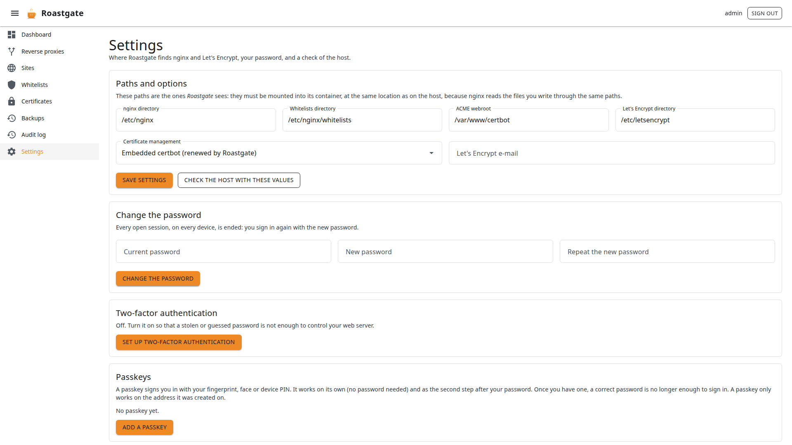

# Settings and configuration

## The Settings page

### Paths and options

The paths and options chosen during the [setup](./first-start.md#3-paths-and-options): nginx directory, whitelists directory, ACME webroot, Let's Encrypt directory, certificate management mode and Let's Encrypt e-mail.

These are the paths **Roastgate sees**: they must be mounted into its container, at the same location as on the host, so that the paths written in your configs mean the same thing for nginx.

- **Check the host with these values** runs the [host diagnostics](./first-start.md#4-host-diagnostics) with what you typed, before you save.
- **Save settings** validates the values the same way as the setup.

### Change the password

Needs the current password. Every open session, on every device, is ended: you sign in again with the new password.

### Two-factor authentication and passkeys

See [Account and security](./account-security.md).

### About this instance

Shows the account you are signed in with, the Roastgate version, how host commands are run, the data directory, and whether forwarded headers and secure cookies are on.

## Environment variables

Set them in the `environment` section of `docker-compose.yml`, then run `docker compose up -d`. All are optional.

| Variable                            | Default              | Purpose                                                                                      |
|-------------------------------------|----------------------|----------------------------------------------------------------------------------------------|
| `ROASTGATE_SETUP_TOKEN`             | random at each start | fixed setup token, 16 characters or more                                                     |
| `ROASTGATE_SECURE_COOKIES`          | `false`              | mark the session cookie `Secure`: enable it when you reach Roastgate over HTTPS              |
| `ROASTGATE_TRUST_FORWARDED_HEADERS` | `false`              | read the client address from `X-Forwarded-For` / `-Proto`: only behind your own reverse proxy |
| `ROASTGATE_DATA_DIR`                | `/data`              | where `roastgate.db` lives (mount a volume there)                                            |
| `ROASTGATE_HOST_EXEC`               | `nsenter`            | `nsenter` runs commands in the host namespaces, `direct` runs them in the container (development) |
| `TZ`                                | `Europe/Paris` in the compose file | time zone of the dates shown in the interface                                  |

See [Reach Roastgate through nginx](./account-security.md#reach-roastgate-through-nginx) for when to enable the cookie and header options.
