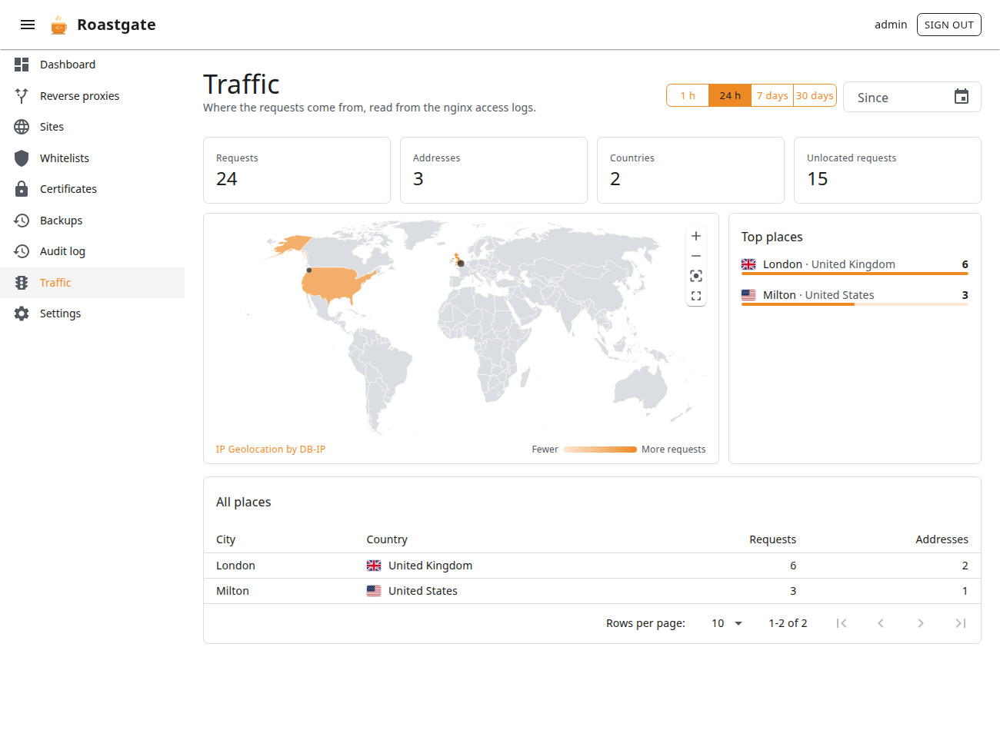
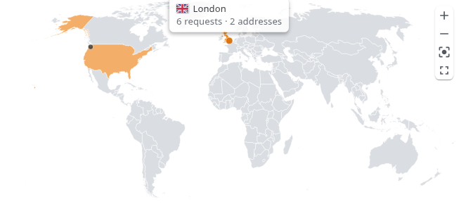

# Traffic

The **Traffic** page shows where the requests to your server come from. Roastgate reads the nginx access logs, looks up each address in the free [DB-IP](https://db-ip.com) city database, and places them on a world map.

Nothing is stored: the page reads the logs again each time you open it or change the period.



## What it needs

- **The nginx logs mounted into the container.** The compose file mounts `/var/log/nginx` read-only since Roastgate 0.4.0. If you installed an earlier version, add the mount (see [Installation](./installation.md#what-the-compose-file-does)):

  ```yaml
  volumes:
    - /var/log/nginx:/var/log/nginx:ro
  ```

- **The DB-IP City Lite database**, `dbip-city-lite.mmdb` in the data volume. Without it, the page still counts the requests, but none of them can be placed on the map. See [The GeoIP database](#the-geoip-database).

## The page

- **Period**: the last hour, 24 hours (the default), 7 days or 30 days, or **Since** a date of your choice (from midnight, in the time zone of the container, `TZ`). Choosing another period while one is loading cancels the first one.
- **Key figures**: the number of requests, of distinct addresses, of countries, and the **unlocated requests** (see below).
- **The map**:
  - each country is shaded by its number of requests, on a logarithmic scale so that one busy country does not wash out all the others;
  - each city is a point, larger when it sends more requests;
  - hovering a country or a city shows its flag, its name and its number of requests (and of addresses, for a city);
  - zoom with the mouse wheel or the **+** and **−** buttons, drag to pan, and reset the view with the center button;
  - the last button shows the map in full screen (not available on iPhone, where Safari only allows videos in full screen).
- **Top places**: the ten cities that sent the most requests, each with a bar relative to the first.
- **All places**: every city with its country, its requests and its addresses, 10 to 100 rows per page, or all of them.



### Unlocated requests

A request is unlocated when its address cannot be placed on the map:

- a private or local address (`127.0.0.1`, `192.168.x.x`, `10.x.x.x`, your Docker network…), such as your own monitoring or a container calling another one;
- an address the database does not know;
- every address, when the database is missing.

They are counted in **Requests** but not in the map, the places or **Addresses**.

## Which logs are read

Roastgate reads the files named `access.log*` in the log directory (`/var/log/nginx`, or `ROASTGATE_NGINX_LOG_DIR`):

- the current `access.log`;
- the rotated files (`access.log.1`…);
- the compressed archives (`access.log.2.gz`…).

Files last written before the start of the period are skipped without being opened, so a short period stays fast even with months of archives.

Each line must start with the client address and hold the date between brackets, as in nginx's default `combined` format:

```text
203.0.113.42 - - [18/Nov/2026:10:12:01 +0100] "GET / HTTP/1.1" 200 612 "-" "Mozilla/5.0"
```

Lines in another format are ignored.

:::info[Per-site logs]
Only files whose name starts with `access.log` are read. A site that logs elsewhere (`access_log /var/log/nginx/app.access.log;`) does not show on the map.
:::

:::caution[Behind a CDN or a proxy]
The address read is the first field of the line, nginx's `$remote_addr`. If your nginx sits behind a CDN or another proxy, that is the address of the proxy, not of the visitor. Configure nginx's [`real_ip` module](https://nginx.org/en/docs/http/ngx_http_realip_module.html) so that the log holds the real address.
:::

## The GeoIP database

Roastgate uses [DB-IP City Lite](https://db-ip.com/db/download/ip-to-city-lite), a free database released every month under the [CC BY 4.0](https://creativecommons.org/licenses/by/4.0/) licence. It is credited under the map. It is not shipped in the image: get it automatically, or copy it by hand.

### Automatic updates

Set `ROASTGATE_GEOIP_AUTO_UPDATE` in `docker-compose.yml`, then run `docker compose up -d`:

```yaml
environment:
  ROASTGATE_GEOIP_AUTO_UPDATE: "true"
```

Five minutes after the container starts, then once a day, Roastgate checks the month of the database it has. When it is older than the current month, it downloads the new one (an archive of about 60 MB from `download.db-ip.com`):

- the download is checked before it replaces the current database, so a corrupt file never takes its place;
- the new database is used right away, without a restart;
- until DB-IP publishes the database of the month, the previous month is downloaded when there is no database at all. Otherwise Roastgate keeps the one it has and tries again the next day.

### By hand

Without automatic updates, download the **MMDB** file from [db-ip.com](https://db-ip.com/db/download/ip-to-city-lite), then copy it into the data volume:

```bash
gunzip dbip-city-lite-2026-11.mmdb.gz
docker cp dbip-city-lite-2026-11.mmdb roastgate:/data/dbip-city-lite.mmdb
docker restart roastgate
```

The file must be named `dbip-city-lite.mmdb`. A database copied by hand is read at startup: restart the container after each copy.
