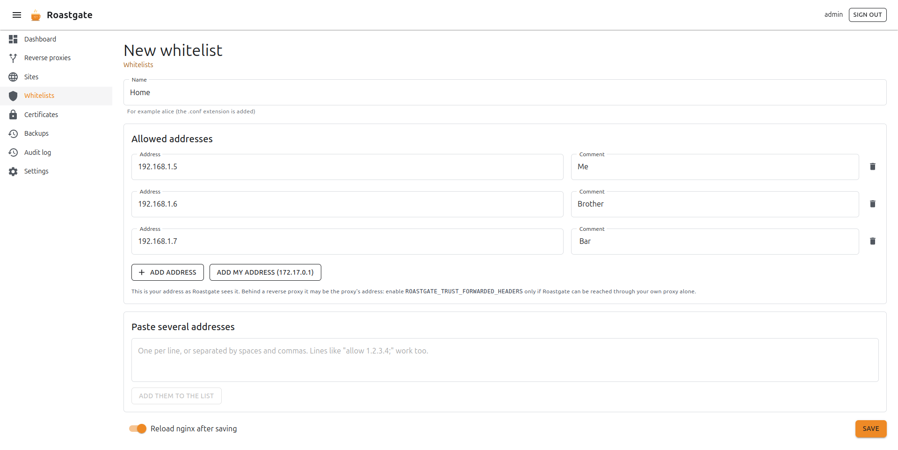
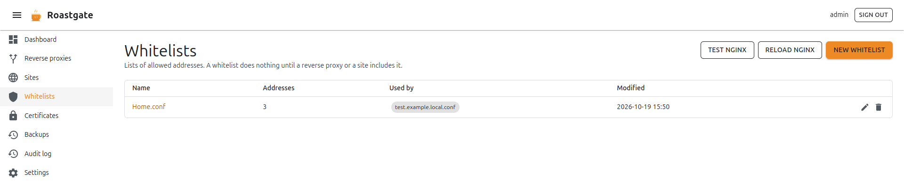

# Whitelists

A whitelist is a file of `allow` lines in the whitelists directory (`/etc/nginx/whitelists` by default):

```nginx title="/etc/nginx/whitelists/office.conf"
allow 203.0.113.10;     # front desk
allow 2001:db8::/32;
```

On its own, it does nothing: it applies wherever a config **includes** it, followed by `deny all;`.

## Create a whitelist

From **Whitelists**, click **New whitelist**.



- **Name**: for example `alice`; the `.conf` extension is added.
- **Allowed addresses**: one address and an optional comment per line. Click **Add address** for a new line.
- **Add my address**: adds the address you are connecting from, as Roastgate sees it.
- **Paste several addresses**: one per line, or separated by spaces and commas. Lines like `allow 1.2.3.4;` work too. Click **Add them to the list**.

Each address is validated as you type: IPv4, IPv6 and CIDR ranges. The validation is strict: `1.2`, `0x7f.0.0.1` or `10.0.0.5/24` (host bits set, which nginx silently ignores) are flagged instead of being written.

:::caution Behind a reverse proxy
If you reach Roastgate through a proxy, **Add my address** may show the proxy's address. Enable `ROASTGATE_TRUST_FORWARDED_HEADERS` only if Roastgate can be reached through your own proxy alone (see [environment variables](./settings-and-configuration.md#environment-variables)).
:::

## Use a whitelist

The easiest way is the **Access** tab of the [wizard](./reverse-proxies-and-sites.md#access): tick the whitelist and save.

In a hand-written config, the whitelist page gives you the lines to copy (**How to use it**). Add them inside the `server` or `location` to restrict:

```nginx
include /etc/nginx/whitelists/office.conf;
deny all;
```

:::warning `return` comes first
nginx evaluates `return` before `allow` and `deny`: a `location` that only does `return 200;` ignores the whitelist.
:::

An empty whitelist allows nobody once it is used with `deny all;`.

## Where is it used?

The **Whitelists** page shows, for each whitelist, its number of addresses and the files that use it.



On the page of a whitelist, the **Used by** section lists every proxy and site that includes the whitelist, with the line number. It understands relative and absolute paths, quoted or not, and wildcard includes. A use in a disabled file is marked as not active.

A whitelist that is still included **cannot be deleted**. For includes in files Roastgate does not read (such as `nginx.conf`), `nginx -t` remains the last safety net.

## Raw editing

The **edit as raw text** link opens the whitelist in the raw editor. A file that holds anything other than `allow` lines (a `deny`, a comment between lines…) is never rewritten by the list editor: Roastgate opens it as raw text instead, so nothing you wrote is lost.
