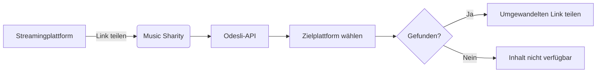

Ich freue mich, die erste Version von **Music Sharity** anzukündigen: eine plattformübergreifende App, die Musiklinks sofort zwischen verschiedenen Streamingdiensten umwandelt!

{/* truncate */}

## Was ist Music Sharity?

[Music Sharity](https://github.com/ByteRoast/music-sharity) ist eine kostenlose Open-Source-App, mit der du Musik mühelos über verschiedene Streamingplattformen hinweg teilen kannst. Schluss mit dem Kopieren von Songtiteln oder der manuellen Suche in verschiedenen Diensten!

## Warum gibt es diese App?

Stell dir vor: Du entdeckst auf Spotify einen großartigen Song und möchtest ihn mit einem Freund teilen. Der nutzt aber Apple Music. Deine Optionen?

1. Ihm nur Titel und Interpret schicken (langweilig)
2. Apple Music öffnen, manuell suchen, den Link kopieren (anstrengend)
3. **Music Sharity nutzen**: sofortige Umwandlung!

## Was kann man teilen?

Aktuell unterstützt Music Sharity:
- **Titel** (einzelne Songs)
- **Alben** (einschließlich EPs und Singles)

:::info
Playlists werden nicht unterstützt, da sie plattformspezifisch sind und sich schlecht zwischen Diensten umwandeln lassen.
:::

## Unterstützte Streamingplattformen

Music Sharity funktioniert derzeit mit den **5 größten Streamingplattformen**:

| Plattform | Marktanteil |
|----------|--------------|
| **Spotify** | 31 % |
| **Apple Music** | 15 % |
| **YouTube Music** | 8 % |
| **Deezer** | 2 % |
| **Tidal** | 1 % |

Für diese erste Version habe ich mich auf die beliebtesten Plattformen konzentriert. Weitere Plattformen könnten in Zukunft hinzukommen, abhängig von der Verfügbarkeit der APIs und dem Interesse der Community!

## Wie bekomme ich Music Sharity?

Music Sharity ist auf mehreren Plattformen verfügbar:

### Web (PWA)
Probiere es direkt in deinem Browser aus unter **[music-sharity.byteroast.fr](https://music-sharity.byteroast.fr)**

Du kannst es auf Android auch als Progressive Web App (PWA) installieren:
1. Öffne die Website in Chrome
2. Tippe auf „Installieren“ oder „Zum Startbildschirm hinzufügen“
3. Music Sharity erscheint in deinem Teilen-Menü!

### Android
- **Google Play Store**: [Bei Google Play herunterladen](https://play.google.com/store/apps/details?id=fr.byteroast.music_sharity)
- **Direkte APK**: Download auf der [GitHub-Releases-Seite](https://github.com/ByteRoast/music-sharity/releases)

### Windows
- **Installer**: Download auf der [GitHub-Releases-Seite](https://github.com/ByteRoast/music-sharity/releases)

### Linux
- **DEB-Paket**: für Debian/Ubuntu-basierte Distributionen
- **RPM-Paket**: für Fedora/RHEL-basierte Distributionen

Beide findest du auf der [GitHub-Releases-Seite](https://github.com/ByteRoast/music-sharity/releases).

:::warning[Verfügbarkeit der Plattformen]
iOS- und macOS-Builds funktionieren, werden aber mangels Hardware nicht offiziell gepflegt. Beiträge aus der Community sind willkommen!
:::

## Wie funktioniert es?

Music Sharity nutzt die [Odesli-API](https://odesli.co) (auch bekannt als song.link), um Links zwischen Plattformen umzuwandeln. Odesli pflegt eine Datenbank der Musik aller großen Streamingdienste und kann Titel anhand verschiedener Kennungen wie ISRC-Codes zuordnen.

**Der Umwandlungsprozess:**

1. Den Quelllink an die Odesli-API senden
2. Alle verfügbaren Plattformlinks abrufen
3. Den umgewandelten Link für die gewählte Plattform anzeigen

### Technische Details

Music Sharity basiert auf zwei Grundprinzipien: Datenschutz und Transparenz.

**Native Apps (Android, Windows, Linux)**
- Direkte API-Aufrufe an Odesli
- Keine Zwischenstellen
- Keine Datenerhebung

**Web-App (PWA)**
- Datenschutzfreundlicher CORS-Proxy über [Cloudflare Workers](https://workers.cloudflare.com)
- Kein Logging, kein Tracking
- Zustandslose Ausführung am Edge
- [Open-Source-Code des Proxys](https://github.com/ByteRoast/music-sharity-proxy)

**Gemeinsamkeiten**
- Keine API-Schlüssel nötig
- Keine Erhebung von Nutzerdaten
- Kein Tracking, keine Analytics
- Vollständig Open Source (GPL v3)

:::info[Warum ein Proxy für das Web?]
Browser setzen CORS-Richtlinien (Cross-Origin Resource Sharing) durch, die direkte Aufrufe externer APIs verhindern. Der Cloudflare-Worker-Proxy existiert nur, um diese Browserbeschränkung zu umgehen, und hält dabei unser Versprechen ein, nichts zu protokollieren.
:::

## Funktionen

- Umwandlung zwischen 5 Plattformen (Spotify, Apple Music, YouTube Music, Deezer, Tidal)
- Unterstützung für Titel und Alben
- Schnelle Umwandlung dank Odesli
- Natives Teilen unter Android (erscheint im Teilen-Menü)
- Unterstützung als Progressive Web App
- Modernes dunkles Design mit Material Design 3
- Datenschutzfreundlich (kein Tracking, keine Analytics, keine Datenerhebung)
- Plattformübergreifend (Web, Android, Windows, Linux)

## Warum „Music Sharity“?

Der Name ist eine Mischung aus:
- **Music** (natürlich!)
- **Share** + **Charity** = **Sharity**

Die Idee ist, Musik plattformübergreifend im Geist von Großzügigkeit und Offenheit zu *teilen*.

## Screenshots

  
  
  

## Wie geht es weiter?

Folgendes ist für kommende Versionen geplant:

- Weitere Streamingplattformen
- Verlauf der Umwandlungen
- Anzeige der Albumcover
- Internationalisierung (Französisch, Deutsch)
- iOS-Unterstützung (Mitwirkende mit Mac gesucht)

## Unser Datenschutzversprechen

Music Sharity ist mit Datenschutz als Grundprinzip gebaut:

- **Keine Benutzerkonten**: einfach öffnen und loslegen
- **Kein Tracking**: keinerlei Analytics oder Telemetrie
- **Keine Datenspeicherung**: alles geschieht in Echtzeit
- **Open Source**: prüfe den Code selbst
- **Transparente Infrastruktur**: sogar unser Web-Proxy ist [Open Source](https://github.com/ByteRoast/music-sharity-proxy)

Details findest du in unserer vollständigen [Datenschutzerklärung](https://music-sharity.byteroast.fr/privacy.html).

## Mitwirken

Music Sharity ist **Open Source** (GPL v3). Beiträge sind willkommen, insbesondere für:

- iOS/macOS-Unterstützung (Mac-Besitzer gesucht)
- Web-Optimierungen
- Integration neuer Plattformen
- Fehlerbehebungen und Dokumentation

Wirf einen Blick in den [Leitfaden für Beiträge](https://github.com/ByteRoast/music-sharity/blob/main/CONTRIBUTING.md), um loszulegen!

## Continuous Integration

Jeder Push wird automatisch auf allen Plattformen getestet:

Unsere CI-Pipeline stellt sicher, dass:
- die Android-APK erfolgreich gebaut wird
- die Web-App korrekt kompiliert
- die Windows-Anwendung ohne Fehler gebaut wird
- die Linux-Pakete (DEB/RPM) korrekt gebaut werden
- der Code die statische Analyse besteht

---

**Probiere Music Sharity noch heute aus und teile deine Musik ganz mühelos!**

- [Web-App ausprobieren](https://music-sharity.byteroast.fr)
- [Auf GitHub herunterladen](https://github.com/ByteRoast/music-sharity/releases)
- [Dem Projekt einen Stern geben](https://github.com/ByteRoast/music-sharity)
- [Probleme melden](https://github.com/ByteRoast/music-sharity/issues)
