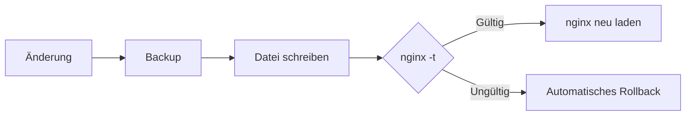

Die erste Version von **Roastgate** ist da: eine selbst gehostete Weboberfläche, die das bereits auf deinem Server installierte nginx steuert. Dein `/etc/nginx` bleibt die einzige Quelle der Wahrheit.

{/* truncate */}

## Was ist Roastgate?

[Roastgate](https://github.com/ByteRoast/Roastgate) ist eine Weboberfläche, die in einem Docker-Container neben deinem nginx läuft. Sie verwaltet **Reverse Proxies**, **gehostete Sites**, **IP-Whitelists** und **Let's-Encrypt-Zertifikate**, ohne jemals die nginx-eigenen Dateien zu verlassen.

Kein eigenes Format, keine versteckte Datenbank mit Konfigurationen: Roastgate liest und schreibt die normalen nginx-Dateien (`conf.d/`, `sites-available/`, `sites-enabled/`). Du kannst sie weiterhin von Hand bearbeiten und jederzeit aufhören, Roastgate zu nutzen. Deine Dateien bleiben, wo sie sind.

:::warning[Alpha]
Roastgate befindet sich in den Alpha-Versionen `0.x`: Einstellungen, das Datenbankschema und das Verhalten können sich zwischen Versionen ändern. Sichere das Datenvolume vor jedem Update.
:::

## Was es verwaltet

| Bereich | Inhalt | Aktivierung |
|---|---|---|
| `conf.d/` | Reverse Proxies | `.conf` und `.conf.disabled` |
| `sites-available/` | gehostete Sites | Symlink in `sites-enabled/` |
| `whitelists/<name>.conf` | `allow <ip>;`-Zeilen | aus deinen Konfigurationen eingebunden |

### Ein sicherer Änderungszyklus

Jede Änderung durchläuft denselben Zyklus:



Schreibvorgänge sind atomar (temporäre Datei, dann Umbenennung) und behalten die ursprünglichen Dateiberechtigungen bei. Die 30 neuesten Backups jeder Datei werden aufbewahrt, und auf der Seite **Backups** kannst du jede Version mit der aktuellen Datei vergleichen und wiederherstellen.

## Funktionen

### Erstellungsassistent

Beschreibe einen Reverse Proxy oder eine statische Site in einem Formular und Roastgate schreibt die nginx-Konfiguration: WebSockets, HTTPS mit optionaler Weiterleitung, HTTP/2, HSTS, Upload-Limit, Timeouts, Sicherheits-Header, Whitelists, die Let's-Encrypt-Challenge und freie Direktiven für alles andere. Ein Vorschau-Tab zeigt genau, was geschrieben wird.

- **Sicher durch Konstruktion**: Jeder Wert wird anhand eines strengen Musters geprüft, bevor er in die Datei gelangt.
- **Kennt dein nginx**: HTTP/2 wird ab nginx 1.25.1 als `http2 on;` geschrieben, davor als `listen ... ssl http2;`.
- **Wieder öffnbar**: Die Einstellungen werden in einem Kommentar am Anfang der generierten Datei gespeichert, sodass das erneute Öffnen das Formular wiederherstellt. Wenn du die Datei von Hand bearbeitet hast, warnt dich der Assistent, bevor er deine Änderungen ersetzt.

### Import von handgeschriebenen Konfigurationen {/* #importing-hand-written-configs */}

Du hast schon Konfigurationen? Öffne eine im Assistenten und ihre Einstellungen werden **aus der Datei gelesen**: Namen, Ports, Upstream, Zertifikat, Whitelists, Upload-Limit, WebSocket-Header, Timeouts, Weiterleitung. Alles, wofür das Formular kein Feld hat, bleibt als freie Direktiven erhalten, sodass nichts verloren geht.

Wenn eine Datei nicht originalgetreu reproduziert werden kann (ein `upstream` auf oberster Ebene, ein `server_name` als Regex, mehr als zwei Server-Blöcke …), wird sie mit Begründung abgelehnt und bleibt als Rohtext bearbeitbar.

### Rohtext-Bearbeitung

Jede Datei kann in einem [Monaco-Editor](https://github.com/microsoft/monaco-editor) mit nginx-Syntaxhervorhebung bearbeitet werden. Einen Proxy oder eine Site zu aktivieren oder zu deaktivieren, ist ein einziger Schalter.

### Let's-Encrypt-Zertifikate

Zertifikate auf der Seite **Certificates** beziehen, auflisten, erneuern und löschen.

- Nutze den **eingebetteten certbot** (im Image enthalten, von Roastgate zweimal täglich erneuert) oder den **auf dem Host installierten**.
- Zertifikate werden aus den Dateien gelesen, die certbot pflegt: Domains, Aussteller, Ablaufdatum und welche deiner Konfigurationen sie verwenden.
- nginx wird nur neu geladen, wenn sich ein Zertifikat wirklich geändert hat.
- Ein **Dry Run** prüft deine Domains zuerst gegen den Staging-Server von Let's Encrypt.
- Ein Zertifikat, das noch von einer Konfiguration verwendet wird, kann nicht gelöscht werden.

:::info
Wildcard-Zertifikate benötigen eine DNS-Challenge und werden nicht unterstützt.
:::

### IP-Whitelists

- Ein Listeneditor mit strenger Prüfung von IPv4, IPv6 und CIDR-Bereichen (`10.0.0.5/24`, das nginx stillschweigend ignoriert, wird markiert).
- Füge viele Adressen auf einmal ein, oder die Adresse, von der aus du verbunden bist, mit einem Klick.
- Jede Whitelist zeigt, **wo sie verwendet wird**, und eine noch eingebundene Whitelist kann nicht gelöscht werden.

## Sicherheit

Roastgate steuert deinen Webserver: Wer Roastgate kontrolliert, ist in der Praxis root auf dem Host. Deshalb hat die Sicherheit in dieser ersten Version viel Aufmerksamkeit bekommen.

- **Zwei-Faktor-Authentifizierung** (TOTP) mit jeder Authenticator-App und zehn Einmal-Wiederherstellungscodes.
- **Passkeys**: Anmeldung per Fingerabdruck, Gesicht, Geräte-PIN oder Sicherheitsschlüssel, allein oder als zweiter Schritt. Sobald ein Passkey existiert, reicht das Passwort allein nicht mehr aus.
- **Rate Limiting**: 5 Fehlversuche pro 15 Minuten und Client-Adresse.
- **Widerruf von Sitzungen**: Eine Passwortänderung beendet alle offenen Sitzungen auf allen Geräten.
- **Audit-Log** jeder Anmeldung und jedes Fehlversuchs.

:::danger[Halte es privat]
Lass den Port auf `127.0.0.1` und greife über einen SSH-Tunnel, ein VPN oder einen nginx-Server-Block zu, der durch eine Whitelist und HTTPS geschützt ist.
:::

## Wie bekomme ich Roastgate? {/* #how-can-i-get-roastgate */}

### Voraussetzungen

- Ein Linux-Server mit **auf dem Host installiertem nginx** (Debian- und Ubuntu-Verzeichnisstrukturen werden unterstützt)
- **Docker** mit dem Compose-Plugin
- Optional: `certbot` auf dem Host

### Installation

Du brauchst nur die Compose-Datei, nicht das ganze Repository. In einem Ordner deiner Wahl:

```bash
mkdir roastgate && cd roastgate
curl -fsSL -o docker-compose.yml https://raw.githubusercontent.com/ByteRoast/Roastgate/refs/heads/main/docker-compose.yml
docker compose up -d
docker logs roastgate        # gibt das Setup-Token aus
```

Oder mit PowerShell (`pwsh`):

```powershell
New-Item -ItemType Directory roastgate | Set-Location
Invoke-WebRequest -Uri https://raw.githubusercontent.com/ByteRoast/Roastgate/refs/heads/main/docker-compose.yml -OutFile docker-compose.yml
docker compose up -d
docker logs roastgate        # gibt das Setup-Token aus
```

Das Image wird unter `ghcr.io/byteroast/roastgate` veröffentlicht. Um bei dieser Version zu bleiben, verwende in `docker-compose.yml` den Tag `0.1.0` statt `latest`.

### Aus dem Quellcode bauen

Um das Image selbst zu bauen, klone das Repository und baue es dort:

```bash
git clone https://github.com/ByteRoast/Roastgate.git
cd Roastgate
docker compose up -d --build
```

### Entwicklungs-Image

Du willst die neuesten Änderungen zuerst? `docker-compose.dev.yml` ist dieselbe Compose-Datei, festgelegt auf das `dev`-Image, das jedem Push auf den `dev`-Branch folgt. Lade sie **als `docker-compose.yml`** herunter, alle anderen Befehle bleiben gleich:

```bash
curl -fsSL -o docker-compose.yml https://raw.githubusercontent.com/ByteRoast/Roastgate/refs/heads/dev/docker-compose.dev.yml
docker compose pull
docker compose up -d
```

```powershell
Invoke-WebRequest -Uri https://raw.githubusercontent.com/ByteRoast/Roastgate/refs/heads/dev/docker-compose.dev.yml -OutFile docker-compose.yml
docker compose pull
docker compose up -d
```

:::warning[Instabil]
Das `dev`-Image bekommt Änderungen zuerst und kann kaputtgehen. Beide Dateien nutzen denselben Container und dasselbe `roastgate-data`-Volume, ein Wechsel behält also dein Konto. Der Weg zurück von `dev` zu `latest` funktioniert jedoch nicht garantiert: `dev` hat die Datenbank womöglich bereits auf ein Schema aktualisiert, das `latest` nicht kennt. **Sichere das Volume, bevor du `dev` ausprobierst.**
:::

### Erster Start

Öffne `http://127.0.0.1:8181` (von deinem eigenen Rechner aus liefert dir `ssh -L 8181:127.0.0.1:8181 user@server` diese Adresse) und folge der Einrichtung:

1. Gib das **Setup-Token** aus den Logs ein
2. Lege das **Administratorkonto** an
3. Wähle die **Pfade und Optionen** (nginx-Verzeichnis, Whitelist-Verzeichnis, ACME-Webroot, certbot-Modus)
4. Prüfe die **Host-Diagnose**
5. Fertig: Du wirst automatisch angemeldet

### Update

Aus dem Ordner, der `docker-compose.yml` enthält:

```bash
docker compose pull
docker compose up -d
```

Lade die Compose-Datei nur dann erneut herunter (derselbe `curl`- oder `Invoke-WebRequest`-Befehl wie oben), wenn die Release Notes sagen, dass sie sich geändert hat. Sie überschreibt deine Kopie, also wiederhole danach deine eigenen Anpassungen (Ports, Mounts, Setup-Token …). Wenn du aus dem Quellcode gebaut hast: `git pull`, dann `docker compose up -d --build`.

### Deine Daten sichern

Die Datenbank liegt im Volume `roastgate-data`, sodass dein Konto und deine Backups Updates und `docker compose down` überstehen. Nur `docker compose down --volumes` (oder `docker volume rm roastgate-data`) löscht es. Zum Sichern:

```bash
docker run --rm -v roastgate-data:/data -v "$PWD":/backup alpine tar czf /backup/roastgate-data.tgz -C /data .
```

### Ausgesperrt?

Passwort vergessen:

```bash
docker exec -it roastgate roastgate reset-password
```

Authenticator-App, Wiederherstellungscodes und Passkeys verloren:

```bash
docker exec roastgate roastgate disable-2fa
```

Das schaltet die Zwei-Faktor-Authentifizierung ab, entfernt alle Passkeys und beendet alle Sitzungen, sodass du dich wieder nur mit dem Passwort anmelden kannst.

### Deinstallation

```bash
docker compose down            # behält das Datenvolume
docker compose down --volumes  # löscht auch Konto, Einstellungen und Backup-Verlauf
```

Lösche dann den Ordner, der `docker-compose.yml` enthält, und das Image mit `docker image rm ghcr.io/byteroast/roastgate:latest` (oder dem Tag, den du verwendet hast). Deine nginx-Dateien bleiben, wo sie sind: Roastgate verschiebt sie nie.

## Technische Details

Roastgate ist mit [.NET 10](https://github.com/dotnet/core) und [MudBlazor](https://github.com/MudBlazor/MudBlazor) gebaut, mit [BlazorMonaco](https://github.com/serdarciplak/BlazorMonaco) für den Editor. Die Daten werden in SQLite gespeichert.

Der Container läuft `privileged` mit `pid: host`, damit er `nginx` und `certbot` über `nsenter` in den Namespaces des Hosts ausführen kann. Befehle werden nie über eine Shell ausgeführt.

## Mitwirken

Fehlerberichte, Ideen, Korrekturen an der Dokumentation und Code sind alle willkommen. Roastgate ist in der Alpha-Phase und wird nach bestem Bemühen gepflegt, Antworten können also ein paar Tage dauern.

- **Einen Fehler gefunden oder ein Feature gewünscht?** Eröffne ein Issue über die [Issue-Formulare](https://github.com/ByteRoast/Roastgate/issues/new/choose). Bei allem, was über eine kleine Korrektur hinausgeht, warte auf eine Antwort, bevor du Code schreibst.
- **Du möchtest Code beitragen?** Forke das Repository, erstelle deinen Branch von **`dev`** aus und öffne deinen Pull Request **gegen `dev`**, nicht `main`. Der [Leitfaden für Beiträge](https://github.com/ByteRoast/Roastgate/blob/main/CONTRIBUTING.md) behandelt Codestil, Tests, Commits und die Lizenzvereinbarung für Mitwirkende.

:::danger[Eine Sicherheitslücke gefunden?]
Eröffne kein öffentliches Issue. Melde sie vertraulich über [GitHubs private Meldung von Sicherheitslücken](https://github.com/ByteRoast/Roastgate/security/advisories/new), wie in der [Sicherheitsrichtlinie](https://github.com/ByteRoast/Roastgate/blob/main/SECURITY.md) beschrieben. Nur das neueste Release und das `dev`-Image erhalten Sicherheitskorrekturen.
:::

## Lizenz

Roastgate ist freie Open-Source-Software unter der Lizenz **AGPL-3.0-or-later**.

---

- [Roastgate auf GitHub](https://github.com/ByteRoast/Roastgate)
- [Release 0.1.0](https://github.com/ByteRoast/Roastgate/releases/tag/v0.1.0)
- [Probleme melden](https://github.com/ByteRoast/Roastgate/issues)
