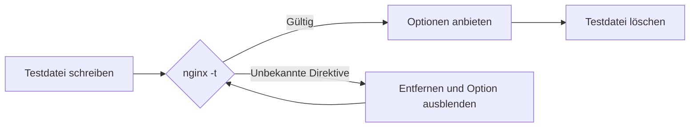

**Roastgate 0.3.0** ist da: Statische Sites können jetzt eine durchsuchbare Verzeichnisliste anzeigen, und Roastgate prüft, was dein nginx wirklich unterstützt, bevor es sie anbietet.

{/* truncate */}

## Durchsuchbare Verzeichnislisten

Eine Site kann jetzt die Dateien ihrer Ordner mit Größe und Datum auflisten, statt mit 403 zu antworten, wenn ein Ordner keine `index.html` hat. Praktisch für einen Downloadbereich, einen Mirror oder einen Ordner mit Build-Artefakten.

Die Liste nutzt das nginx-Modul [fancyindex](https://github.com/aperezdc/ngx-fancyindex). Schalte im Tab **Essentials** des Site-Assistenten **Browsable directory listing (fancyindex)** ein und wähle die Optionen:

- **Sortierung**: nach Name, Größe oder Datum, auf- oder absteigend, Ordner zuerst oder nicht.
- **Anzeige**: exakte oder gerundete Größen, Ortszeit oder UTC, dein eigenes Datumsformat, der Pfad über der Liste.
- **Ausblenden**: Dotfiles, Symlinks, der Link zum übergeordneten Ordner und eine Liste auszulassender Namen.
- **Theme**: deine eigenen Header-, Footer- und CSS-Dateien.

Wie immer zeigt der Vorschau-Tab genau, was geschrieben wird. Eine Liste nach Datum sortiert, die neuesten zuerst:

```nginx
location / {
    try_files $uri $uri/ =404;
    fancyindex on;
    fancyindex_exact_size on;
    fancyindex_localtime off;
    fancyindex_show_path on;
    fancyindex_directories_first on;
    fancyindex_show_dotfiles off;
    fancyindex_hide_symlinks off;
    fancyindex_hide_parent_dir off;
    fancyindex_default_sort date_desc;
    fancyindex_time_format "%Y-%b-%d %H:%M";
}
```

Ein paar Schutzmechanismen sind dabei:

- **Show dotfiles** wird abgelehnt, solange **Block TRACE and dotfiles** an ist, denn dieser Schutz lehnt jeden Pfad ab, der mit einem Punkt beginnt.
- Ein Theme in einem Punkt-Ordner (wie `/.nginxy/`) wird durch den Dotfile-Schutz gelassen: nur die Ordner deiner Header-, Footer- und CSS-Dateien, sonst nichts.
- Die Header-, Footer- und CSS-Pfade und das Datumsformat werden geprüft, bevor sie in die Datei gelangen.

Vorhandene `fancyindex`-Direktiven werden auch gelesen, wenn du eine [handgeschriebene Konfiguration importierst](/docs/roastgate/reverse-proxies-and-sites#importing-a-hand-written-config).

## Kennt die Module deines nginx

fancyindex ist nicht Teil von nginx selbst. Roastgate liest jetzt die Module, die dein nginx lädt (`nginx -T`), und bietet die Liste nur an, wenn fancyindex dazugehört. Fehlt es, ist der Schalter ausgegraut und der Assistent sagt dir, was du installieren musst:

```bash
sudo apt install libnginx-mod-http-fancyindex
sudo systemctl reload nginx
```

### Builds eines Moduls unterscheiden sich

Auch wenn das Modul geladen ist, kennt nicht jeder Build jede Direktive. Ubuntus `libnginx-mod-http-fancyindex` 0.5.2 zum Beispiel hat kein `fancyindex_case_sensitive`, und nginx lehnt eine ganze Datei ab, die eine unbekannte Direktive nennt.

Aus einer Versionsnummer zu raten ist nicht zuverlässig, also fragt Roastgate nginx selbst. Es schreibt eine kleine Testkonfiguration nach `/etc/nginx/.roastgate-probe`, mit deinen `load_module`-Zeilen und den optionalen Direktiven, führt `nginx -t` darauf aus und löscht sie sofort wieder:



Deine Konfiguration wird nie angefasst. Eine Option, die nginx nicht kennt, wird im Assistenten ausgeblendet, und wenn nginx gar nicht gefragt werden kann, bleibt die Option verfügbar und `nginx -t` behält beim Speichern das letzte Wort.

:::info
Die Antworten von nginx werden fünf Minuten lang behalten. Warte nach der Installation eines anderen Builds eines Moduls fünf Minuten oder starte Roastgate neu.
:::

Die [Dokumentation](/docs/roastgate/reverse-proxies-and-sites#directory-listing) beschreibt jede Option.

## Für Mitwirkende

Jede Datei der Codebasis deklariert jetzt einen einzigen Top-Level-Typ, eine Regel, die nun im [Contributing Guide](https://github.com/ByteRoast/Roastgate/blob/main/CONTRIBUTING.md) steht. Für Nutzer ändert sich nichts, aber man findet sich im Code leichter zurecht.

Die vollständige Dokumentation ist außerdem aus der README auf [diese Website](/docs/roastgate/) umgezogen: Die README behält das Wesentliche und verlinkt darauf.

## Wie bekomme ich Roastgate 0.3.0?

### Update

Aus dem Ordner, der `docker-compose.yml` enthält:

```bash
docker compose pull
docker compose up -d
```

Die Compose-Datei hat sich in diesem Release nicht geändert: Du musst sie nicht erneut herunterladen.

:::warning[Alpha]
Roastgate befindet sich noch in seinen `0.x`-Alpha-Releases. Sichere das Volume `roastgate-data` vor dem Update:

```bash
docker run --rm -v roastgate-data:/data -v "$PWD":/backup alpine tar czf /backup/roastgate-data.tgz -C /data .
```
:::

Um auf dieser Version zu bleiben, verwende in `docker-compose.yml` den Tag `0.3.0` statt `latest`.

### Neuinstallation

Folge der [Installationsanleitung](/docs/roastgate/installation) oder dem Beitrag [Vorstellung von Roastgate 0.1.0](/blog/roastgate-0.1.0#how-can-i-get-roastgate): Die Schritte sind dieselben.

---

- [Roastgate auf GitHub](https://github.com/ByteRoast/Roastgate)
- [Release 0.3.0](https://github.com/ByteRoast/Roastgate/releases/tag/v0.3.0)
- [Probleme melden](https://github.com/ByteRoast/Roastgate/issues)
