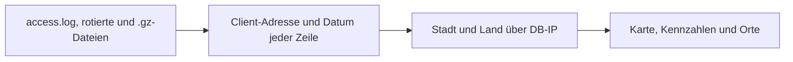

**Roastgate 0.4.0** ist da: Eine neue Seite **Traffic** zeigt auf einer Weltkarte, woher die Anfragen an deinen Server kommen, und das Ergebnis einer Aktion erscheint jetzt als Toast, nahe an der Stelle, an der du arbeitest.

{/* truncate */}

## Woher dein Traffic kommt

Die neue Seite **Traffic**, im Menü zwischen **Audit log** und **Settings**, liest die nginx-Access-Logs und platziert jede Anfrage auf einer Weltkarte:



- **Ein Zeitraum** zur Auswahl: die letzte Stunde, 24 Stunden, 7 Tage, 30 Tage oder ab einem Datum.
- **Kennzahlen**: Anfragen, verschiedene Adressen, Länder und die Anfragen, die nicht lokalisiert werden konnten (private Adressen, dein eigenes Docker-Netzwerk …).
- **Die Karte**: Länder nach ihrer Anzahl an Anfragen eingefärbt, auf einer logarithmischen Skala, damit ein sehr aktives Land die anderen nicht überdeckt, und ein Punkt pro Stadt. Fahre über ein Land oder eine Stadt, um Flagge und Zahlen zu sehen. Zoomen, verschieben und im Vollbild öffnen.
- **Die Orte**: die zehn wichtigsten Städte mit je einem Balken und eine Tabelle aller Städte mit Seitenumbruch.

Roastgate liest die aktuelle `access.log`, die rotierten Dateien und die `.gz`-Archive im Standardformat `combined` von nginx. Dateien, die zuletzt vor dem gewählten Zeitraum geschrieben wurden, werden übersprungen, ohne sie zu öffnen: Ein kurzer Zeitraum bleibt auch mit monatelangen Archiven schnell. Es wird nichts gespeichert: Die Seite liest die Logs jedes Mal neu.

### Die GeoIP-Datenbank

Die Adressen werden mit [DB-IP City Lite](https://db-ip.com/db/download/ip-to-city-lite) lokalisiert, einer kostenlosen Datenbank, die jeden Monat unter CC BY 4.0 erscheint. Sie ist nicht im Image enthalten. Damit Roastgate sie herunterlädt und aktuell hält, setze eine Variable in `docker-compose.yml`:

```yaml
environment:
  ROASTGATE_GEOIP_AUTO_UPDATE: "true"
```

Fünf Minuten nach dem Start und danach einmal am Tag prüft Roastgate, ob eine neuere Monatsdatenbank erschienen ist. Es lädt sie herunter (etwa 60 MB), prüft, ob die Datei gültig ist, und tauscht sie ohne Neustart aus. Du kannst die Datei auch von Hand kopieren.

Die [Dokumentation](/docs/roastgate/traffic) beschreibt die Seite, die gelesenen Logs und die Datenbank.

:::caution[Hinter einem CDN oder Proxy]
Die Karte zeigt die Adresse, die nginx als Client protokolliert. Hinter einem CDN ist das die des CDN, es sei denn, das [`real_ip`-Modul](https://nginx.org/en/docs/http/ngx_http_realip_module.html) von nginx ist eingerichtet.
:::

## Ergebnisse von Aktionen als Toasts

Eine Datei speichern, eine Site aktivieren, ein Backup wiederherstellen oder certbot ausführen zeigte sein Ergebnis bisher als Hinweis oben auf der Seite. Der konnte weit von der geklickten Schaltfläche entfernt sein und blieb stehen, lange nachdem er nicht mehr nützlich war.

Ein Erfolg erscheint jetzt als kurzer **Toast** oben auf dem Bildschirm, der die Datei nennt: `app.example.com.conf: Saved. nginx reloaded.` Er verschwindet nach fünf Sekunden.

Was du lesen musst, bleibt auf der Seite:

- ein **Fehler oder eine Warnung** bleibt auf der Seite, mit der Ausgabe von `nginx -t` oder certbot, damit du sie lesen kannst, während du das Problem behebst;
- **Hinweise zu einem Zustand** (nginx nicht erreichbar, ein fehlendes Verzeichnis, eine von Hand bearbeitete Datei …) und Formularfehler ändern sich nicht.

Das Löschen einer Datei aus ihrem Editor bestätigt jetzt auch, dass es erledigt ist: Der Toast erscheint auf der Liste, zu der du zurückgeleitet wirst. Konnte nginx nicht neu geladen werden, ist dieser Toast eine Warnung, die bleibt, bis du sie schließt.

## Für Mitwirkende

Die End-to-End-Suite, die die echte Oberfläche gegen ein echtes nginx steuert, ist von einer einzigen JavaScript-Datei zu **TypeScript**-Modulen umgezogen, die Node direkt ausführt, mit **pnpm**-Skripten, um die Images zu bauen und einen frischen Container zu starten. Sie liegt jetzt in `tests/Roastgate.E2E`, gehört zur Solution und macht von jedem Abschnitt einen Screenshot. Ihre [README](https://github.com/ByteRoast/Roastgate/blob/main/tests/Roastgate.E2E/README.md) erklärt, wie man sie ausführt und eine Prüfung hinzufügt.

## Wie bekomme ich Roastgate 0.4.0?

### Update

Die Compose-Datei hat sich in diesem Release geändert: Sie hängt die nginx-Logs schreibgeschützt für die Seite Traffic ein. Lade sie entweder [erneut herunter](/docs/roastgate/installation#install), was deine eigenen Anpassungen überschreibt, oder füge den Mount zu deiner Kopie hinzu:

```yaml
volumes:
  - /var/log/nginx:/var/log/nginx:ro
```

Dann, aus dem Ordner, der `docker-compose.yml` enthält:

```bash
docker compose pull
docker compose up -d
```

:::warning[Alpha]
Roastgate befindet sich noch in seinen `0.x`-Alpha-Releases. Sichere das Volume `roastgate-data` vor dem Update:

```bash
docker run --rm -v roastgate-data:/data -v "$PWD":/backup alpine tar czf /backup/roastgate-data.tgz -C /data .
```

:::

Um auf dieser Version zu bleiben, verwende in `docker-compose.yml` den Tag `0.4.0` statt `latest`.

### Neuinstallation

Folge der [Installationsanleitung](/docs/roastgate/installation) oder dem Beitrag [Vorstellung von Roastgate 0.1.0](/blog/roastgate-0.1.0#how-can-i-get-roastgate): Die Schritte sind dieselben.

---

- [Roastgate auf GitHub](https://github.com/ByteRoast/Roastgate)
- [Release 0.4.0](https://github.com/ByteRoast/Roastgate/releases/tag/v0.4.0)
- [Probleme melden](https://github.com/ByteRoast/Roastgate/issues)
