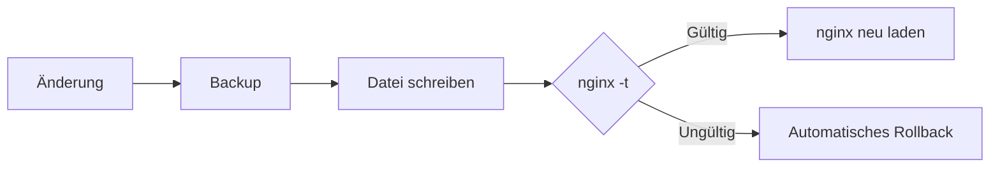

# Roastgate

Roastgate ist eine Weboberfläche, die das **auf deinem Server installierte nginx** steuert. Es läuft in einem Docker-Container neben nginx und verwaltet:

- **Reverse Proxies**: eine Domain an eine Anwendung oder einen Container weiterleiten.
- **Sites**: statische Dateien ausliefern (eine Website, eine Single Page Application).
- **IP-Whitelists**: einen Proxy oder eine Site auf bestimmte Adressen beschränken.
- **Let's-Encrypt-Zertifikate**: sie beziehen, erneuern und löschen.

Roastgate verwendet nie ein eigenes Format: Es liest und schreibt die normalen nginx-Dateien. Dein `/etc/nginx` bleibt die einzige Quelle der Wahrheit, du kannst die Dateien also weiterhin von Hand bearbeiten und jederzeit aufhören, Roastgate zu nutzen, ohne etwas zu verlieren.

:::warning[Alpha]
Roastgate befindet sich in den Alpha-Versionen `0.x`: Einstellungen, das Datenbankschema und das Verhalten können sich zwischen Versionen ändern. [Sichere das Datenvolume](./maintenance.md#back-up-the-data) vor jedem Update.
:::

## Was es verwaltet

| Bereich                  | Inhalt              | Ort                          | Aktiv, wenn                                      |
|--------------------------|---------------------|------------------------------|--------------------------------------------------|
| Reverse Proxies          | `server`-Blöcke     | `conf.d/<name>.conf`         | die Datei auf `.conf` endet (nicht `.conf.disabled`) |
| Sites                    | `server`-Blöcke     | `sites-available/<name>`     | ein Symlink in `sites-enabled/` existiert        |
| Whitelists               | `allow <ip>;`-Zeilen| `whitelists/<name>.conf`     | eine Konfiguration sie per `include` einbindet   |
| Zertifikate              | Let's Encrypt       | `/etc/letsencrypt`           | eine Konfiguration darauf verweist               |

Die Verzeichnisstrukturen von Debian und Ubuntu (`conf.d/`, `sites-available/`, `sites-enabled/`) werden unterstützt.

## Ein sicherer Änderungszyklus

Jede Änderung über Roastgate (Speichern, Aktivieren, Deaktivieren, Löschen, Wiederherstellen) durchläuft denselben Zyklus:

- Der vorherige Inhalt wird als **Backup** aufbewahrt (die 30 neuesten pro Datei), siehe [Backups](./backups-and-audit-log.md).
- Schreibvorgänge sind **atomar** (temporäre Datei, dann Umbenennung) und behalten die ursprünglichen Dateiberechtigungen bei.
- Wenn `nginx -t` fehlschlägt, wird die Änderung **rückgängig gemacht** und der nginx-Fehler angezeigt. nginx läuft mit der vorherigen Konfiguration weiter.
- Wenn `nginx -t` bereits aus einem Grund fehlschlug, der nichts mit deiner Änderung zu tun hat, wird die Änderung ebenfalls rückgängig gemacht, und Roastgate teilt dir das mit.

## Wo anfangen

1. [Installiere Roastgate](./installation.md) auf deinem Server.
2. Führe die [Ersteinrichtung](./first-start.md) durch.
3. Erstelle deinen ersten [Reverse Proxy oder deine erste Site](./reverse-proxies-and-sites.md).
4. Schütze dein Konto mit [Zwei-Faktor-Authentifizierung oder einem Passkey](./account-security.md).
