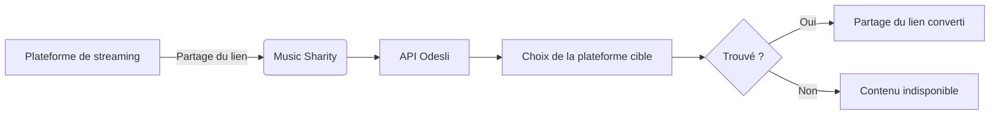

J'ai le plaisir d'annoncer la première version de **Music Sharity**, une application multiplateforme qui convertit instantanément les liens musicaux entre les différents services de streaming !

{/* truncate */}

## Qu'est-ce que Music Sharity ?

[Music Sharity](https://github.com/ByteRoast/music-sharity) est une application libre et open source qui vous permet de partager de la musique entre différentes plateformes de streaming sans effort. Fini le copier-coller de titres ou les recherches manuelles sur chaque service !

## Pourquoi cette application existe-t-elle ?

Imaginez : vous découvrez une chanson géniale sur Spotify et vous voulez la partager avec un ami. Mais il utilise Apple Music. Vos options ?

1. Lui envoyer juste le titre et l'artiste (ennuyeux)
2. Ouvrir Apple Music, chercher manuellement, copier le lien (épuisant)
3. **Utiliser Music Sharity** : conversion instantanée !

## Que peut-on partager ?

Actuellement, Music Sharity prend en charge :
- **Les titres** (morceaux individuels)
- **Les albums** (y compris les EP et les singles)

:::info
Les playlists ne sont pas prises en charge, car elles sont propres à chaque plateforme et se convertissent mal d'un service à l'autre.
:::

## Plateformes de streaming prises en charge

Music Sharity fonctionne actuellement avec les **5 principales plateformes de streaming** :

| Plateforme | Part de marché |
|----------|--------------|
| **Spotify** | 31 % |
| **Apple Music** | 15 % |
| **YouTube Music** | 8 % |
| **Deezer** | 2 % |
| **Tidal** | 1 % |

Pour cette première version, je me suis concentré sur les plateformes les plus populaires. D'autres pourront être ajoutées à l'avenir, selon la disponibilité des API et l'intérêt de la communauté !

## Comment obtenir Music Sharity ?

Music Sharity est disponible sur plusieurs plateformes :

### Web (PWA)
Essayez-la directement dans votre navigateur sur **[music-sharity.byteroast.fr](https://music-sharity.byteroast.fr)**

Vous pouvez aussi l'installer comme Progressive Web App (PWA) sur Android :
1. Ouvrez le site dans Chrome
2. Appuyez sur « Installer » ou « Ajouter à l'écran d'accueil »
3. Music Sharity apparaîtra dans votre menu de partage !

### Android
- **Google Play Store** : [Télécharger sur Google Play](https://play.google.com/store/apps/details?id=fr.byteroast.music_sharity)
- **APK direct** : téléchargez-le depuis la [page des releases GitHub](https://github.com/ByteRoast/music-sharity/releases)

### Windows
- **Installeur** : téléchargez-le depuis la [page des releases GitHub](https://github.com/ByteRoast/music-sharity/releases)

### Linux
- **Paquet DEB** : pour les distributions basées sur Debian/Ubuntu
- **Paquet RPM** : pour les distributions basées sur Fedora/RHEL

Les deux sont disponibles sur la [page des releases GitHub](https://github.com/ByteRoast/music-sharity/releases).

:::warning[Disponibilité des plateformes]
Les builds iOS et macOS fonctionnent, mais ne sont pas maintenus officiellement faute de matériel. Les contributions de la communauté sont les bienvenues !
:::

## Comment ça marche ?

Music Sharity utilise l'[API Odesli](https://odesli.co) (aussi connue sous le nom de song.link) pour convertir les liens entre plateformes. Odesli maintient une base de données de la musique présente sur tous les grands services de streaming et peut faire correspondre les titres grâce à divers identifiants comme les codes ISRC.

**Le processus de conversion :**

1. Envoi du lien source à l'API Odesli
2. Récupération de tous les liens disponibles par plateforme
3. Affichage du lien converti pour la plateforme choisie

### Détails techniques

Music Sharity repose sur deux principes fondamentaux : la confidentialité et la transparence.

**Applications natives (Android, Windows, Linux)**
- Appels directs à l'API Odesli
- Aucun intermédiaire
- Aucune collecte de données

**Application web (PWA)**
- Proxy CORS respectueux de la vie privée via [Cloudflare Workers](https://workers.cloudflare.com)
- Aucun log, aucun pistage
- Exécution en edge, sans état
- [Code du proxy open source](https://github.com/ByteRoast/music-sharity-proxy)

**Points communs**
- Aucune clé d'API requise
- Aucune collecte de données utilisateur
- Aucun pistage ni analytics
- Entièrement open source (GPL v3)

:::info[Pourquoi un proxy pour le web ?]
Les navigateurs appliquent des politiques CORS (Cross-Origin Resource Sharing) qui empêchent les appels directs vers des API externes. Le proxy Cloudflare Worker n'existe que pour contourner cette limitation du navigateur, tout en respectant notre engagement de ne rien journaliser.
:::

## Fonctionnalités

- Conversion entre 5 plateformes (Spotify, Apple Music, YouTube Music, Deezer, Tidal)
- Prise en charge des titres et des albums
- Conversion rapide grâce à Odesli
- Partage natif sur Android (apparaît dans le menu de partage)
- Prise en charge en tant que Progressive Web App
- Thème sombre moderne avec Material Design 3
- Respect de la vie privée (pas de pistage, pas d'analytics, pas de collecte de données)
- Multiplateforme (Web, Android, Windows, Linux)

## Pourquoi « Music Sharity » ?

Le nom est un mélange de :
- **Music** (évidemment !)
- **Share** + **Charity** = **Sharity**

L'idée est de *partager* la musique entre les plateformes dans un esprit de générosité et d'ouverture.

## Captures d'écran

  
  
  

## Et ensuite ?

Voici ce qui est prévu pour les prochaines versions :

- D'autres plateformes de streaming
- Historique des conversions
- Affichage des pochettes d'album
- Internationalisation (français, allemand)
- Prise en charge d'iOS (contributeurs avec un Mac recherchés)

## Engagement sur la confidentialité

Music Sharity est conçue avec la confidentialité comme principe fondamental :

- **Pas de compte utilisateur** : il suffit d'ouvrir l'application
- **Pas de pistage** : aucune analytics ni télémétrie
- **Pas de stockage de données** : tout se passe en temps réel
- **Open source** : auditez le code vous-même
- **Infrastructure transparente** : même notre proxy web est [open source](https://github.com/ByteRoast/music-sharity-proxy)

Consultez notre [politique de confidentialité](https://music-sharity.byteroast.fr/privacy.html) complète pour plus de détails.

## Contribuer

Music Sharity est **open source** (GPL v3). Les contributions sont les bienvenues, en particulier pour :

- La prise en charge d'iOS/macOS (propriétaires de Mac recherchés)
- Les optimisations web
- L'intégration de nouvelles plateformes
- Les corrections de bugs et la documentation

Consultez le [guide de contribution](https://github.com/ByteRoast/music-sharity/blob/main/CONTRIBUTING.md) pour commencer !

## Intégration continue

Chaque push est automatiquement testé sur toutes les plateformes :

Notre pipeline de CI garantit que :
- L'APK Android se compile correctement
- L'application web se compile correctement
- L'exécutable Windows se compile sans erreur
- Les paquets Linux (DEB/RPM) se construisent correctement
- Le code passe l'analyse statique

---

**Essayez Music Sharity dès aujourd'hui et partagez votre musique sans effort !**

- [Essayer l'application web](https://music-sharity.byteroast.fr)
- [Télécharger sur GitHub](https://github.com/ByteRoast/music-sharity/releases)
- [Mettre une étoile au projet](https://github.com/ByteRoast/music-sharity)
- [Signaler un problème](https://github.com/ByteRoast/music-sharity/issues)
