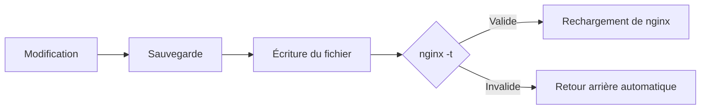

La première version de **Roastgate** est sortie : une interface web auto-hébergée qui pilote le nginx déjà installé sur votre serveur. Votre `/etc/nginx` reste la source de vérité.

{/* truncate */}

## Qu'est-ce que Roastgate ?

[Roastgate](https://github.com/ByteRoast/Roastgate) est une interface web qui tourne dans un conteneur Docker à côté de votre nginx. Elle gère les **reverse proxies**, les **sites hébergés**, les **listes blanches d'IP** et les **certificats Let's Encrypt**, sans jamais sortir des fichiers propres à nginx.

Pas de format maison, pas de base de configurations cachée : Roastgate lit et écrit les fichiers nginx classiques (`conf.d/`, `sites-available/`, `sites-enabled/`). Vous pouvez continuer à les modifier à la main, et arrêter d'utiliser Roastgate à tout moment. Vos fichiers restent là où ils sont.

:::warning[Alpha]
Roastgate en est à ses versions alpha `0.x` : les réglages, le schéma de la base de données et le comportement peuvent changer d'une version à l'autre. Gardez une sauvegarde du volume de données avant chaque mise à jour.
:::

## Ce qu'elle gère

| Emplacement | Contenu | Activation |
|---|---|---|
| `conf.d/` | reverse proxies | `.conf` et `.conf.disabled` |
| `sites-available/` | sites hébergés | lien symbolique dans `sites-enabled/` |
| `whitelists/<name>.conf` | lignes `allow <ip>;` | incluses depuis vos configurations |

### Un cycle de modification sûr

Chaque modification suit le même cycle :



Les écritures sont atomiques (fichier temporaire, puis renommage) et conservent les permissions d'origine du fichier. Les 30 sauvegardes les plus récentes de chaque fichier sont conservées, et la page **Backups** permet de comparer n'importe quelle version avec le fichier actuel et de la restaurer.

## Fonctionnalités

### Assistant de création

Décrivez un reverse proxy ou un site statique dans un formulaire et Roastgate écrit la configuration nginx : WebSockets, HTTPS avec redirection optionnelle, HTTP/2, HSTS, limite d'upload, timeouts, en-têtes de sécurité, listes blanches, challenge Let's Encrypt, et directives libres pour tout le reste. Un onglet d'aperçu montre exactement ce qui sera écrit.

- **Sûr par construction** : chaque valeur est validée par un motif strict avant d'arriver dans le fichier.
- **Adapté à votre nginx** : HTTP/2 est écrit sous la forme `http2 on;` à partir de nginx 1.25.1, et `listen ... ssl http2;` avant.
- **Réouvrable** : les réglages sont stockés dans un commentaire en tête du fichier généré, donc le rouvrir restaure le formulaire. Si vous avez modifié le fichier à la main, l'assistant vous prévient avant d'écraser vos changements.

### Import de configurations écrites à la main {/* #importing-hand-written-configs */}

Vous avez déjà des configurations ? Ouvrez-en une dans l'assistant et ses réglages sont **lus depuis le fichier** : noms, ports, upstream, certificat, listes blanches, limite d'upload, en-têtes WebSocket, timeouts, redirection. Tout ce qui n'a pas de champ dans le formulaire est conservé en directives libres, donc rien n'est perdu.

Lorsqu'un fichier ne peut pas être reproduit fidèlement (un `upstream` au niveau racine, un `server_name` en regex, plus de deux blocs server…), il est refusé avec la raison et reste modifiable en texte brut.

### Édition brute

Chaque fichier peut être modifié dans un [éditeur Monaco](https://github.com/microsoft/monaco-editor) avec coloration syntaxique nginx. Activer ou désactiver un proxy ou un site se fait d'un simple interrupteur.

### Certificats Let's Encrypt

Obtenez, listez, renouvelez et supprimez des certificats depuis la page **Certificates**.

- Utilisez le **certbot intégré** (livré dans l'image, renouvelé deux fois par jour par Roastgate) ou celui **installé sur l'hôte**.
- Les certificats sont lus depuis les fichiers que maintient certbot : domaines, émetteur, expiration, et lesquelles de vos configurations les utilisent.
- nginx n'est rechargé que lorsqu'un certificat a réellement changé.
- Un **dry run** valide d'abord vos domaines auprès du serveur de staging de Let's Encrypt.
- Un certificat encore utilisé par une configuration ne peut pas être supprimé.

:::info
Les certificats wildcard nécessitent un challenge DNS et ne sont pas pris en charge.
:::

### Listes blanches d'IP

- Un éditeur de liste avec validation stricte des adresses IPv4, IPv6 et des plages CIDR (`10.0.0.5/24`, que nginx ignore silencieusement, est signalé).
- Collez de nombreuses adresses d'un coup, ou ajoutez celle depuis laquelle vous êtes connecté en un clic.
- Chaque liste blanche indique **où elle est utilisée**, et une liste encore incluse ne peut pas être supprimée.

## Sécurité

Roastgate contrôle votre serveur web : quiconque contrôle Roastgate est, en pratique, root sur l'hôte. La sécurité a donc reçu beaucoup d'attention pour cette première version.

- **Authentification à deux facteurs** (TOTP) avec n'importe quelle application d'authentification, et dix codes de récupération à usage unique.
- **Passkeys** : connectez-vous avec une empreinte digitale, votre visage, le code PIN de l'appareil ou une clé de sécurité, seules ou comme second facteur. Dès qu'une passkey existe, le mot de passe seul ne suffit plus.
- **Limitation de débit** : 5 échecs par tranche de 15 minutes et par adresse client.
- **Révocation des sessions** : changer le mot de passe met fin à toutes les sessions ouvertes, sur tous les appareils.
- **Journal d'audit** de chaque connexion et de chaque échec.

:::danger[Gardez-la privée]
Laissez le port sur `127.0.0.1` et accédez-y via un tunnel SSH, un VPN, ou un bloc server nginx protégé par une liste blanche et HTTPS.
:::

## Comment obtenir Roastgate ? {/* #how-can-i-get-roastgate */}

### Prérequis

- Un serveur Linux avec **nginx installé sur l'hôte** (les arborescences Debian et Ubuntu sont prises en charge)
- **Docker** avec le plugin Compose
- Optionnel : `certbot` sur l'hôte

### Installation

Vous n'avez besoin que du fichier compose, pas du dépôt entier. Dans le dossier de votre choix :

```bash
mkdir roastgate && cd roastgate
curl -fsSL -o docker-compose.yml https://raw.githubusercontent.com/ByteRoast/Roastgate/refs/heads/main/docker-compose.yml
docker compose up -d
docker logs roastgate        # affiche le jeton d'installation
```

Ou avec PowerShell (`pwsh`) :

```powershell
New-Item -ItemType Directory roastgate | Set-Location
Invoke-WebRequest -Uri https://raw.githubusercontent.com/ByteRoast/Roastgate/refs/heads/main/docker-compose.yml -OutFile docker-compose.yml
docker compose up -d
docker logs roastgate        # affiche le jeton d'installation
```

L'image est publiée sur `ghcr.io/byteroast/roastgate`. Pour rester sur cette version, utilisez le tag `0.1.0` au lieu de `latest` dans `docker-compose.yml`.

### Compiler depuis les sources

Pour construire l'image vous-même, clonez le dépôt et construisez-la depuis celui-ci :

```bash
git clone https://github.com/ByteRoast/Roastgate.git
cd Roastgate
docker compose up -d --build
```

### Image de développement

Vous voulez les dernières nouveautés en avant-première ? `docker-compose.dev.yml` est le même fichier compose, épinglé sur l'image `dev`, qui suit chaque push sur la branche `dev`. Téléchargez-le **sous le nom `docker-compose.yml`** et toutes les autres commandes restent identiques :

```bash
curl -fsSL -o docker-compose.yml https://raw.githubusercontent.com/ByteRoast/Roastgate/refs/heads/dev/docker-compose.dev.yml
docker compose pull
docker compose up -d
```

```powershell
Invoke-WebRequest -Uri https://raw.githubusercontent.com/ByteRoast/Roastgate/refs/heads/dev/docker-compose.dev.yml -OutFile docker-compose.yml
docker compose pull
docker compose up -d
```

:::warning[Instable]
L'image `dev` reçoit les changements en premier et peut casser. Les deux fichiers utilisent le même conteneur et le même volume `roastgate-data`, donc changer de l'un à l'autre conserve votre compte. En revanche, revenir de `dev` à `latest` n'est pas garanti : `dev` a peut-être déjà migré la base de données vers un schéma que `latest` ne connaît pas. **Sauvegardez le volume avant d'essayer `dev`.**
:::

### Premier démarrage

Ouvrez `http://127.0.0.1:8181` (depuis votre propre machine, `ssh -L 8181:127.0.0.1:8181 user@server` vous donne cette adresse) et suivez l'installation :

1. Saisissez le **jeton d'installation** affiché dans les logs
2. Créez le compte **administrateur**
3. Choisissez les **chemins et options** (répertoire nginx, répertoire des listes blanches, webroot ACME, mode certbot)
4. Vérifiez les **diagnostics de l'hôte**
5. Terminé : vous êtes connecté automatiquement

### Mise à jour

Depuis le dossier qui contient `docker-compose.yml` :

```bash
docker compose pull
docker compose up -d
```

Ne retéléchargez le fichier compose (même commande `curl` ou `Invoke-WebRequest` que ci-dessus) que lorsque les notes de version indiquent qu'il a changé. Il écrase votre copie, donc refaites vos propres modifications ensuite (ports, montages, jeton d'installation…). Si vous avez compilé depuis les sources : `git pull`, puis `docker compose up -d --build`.

### Sauvegarder vos données

La base de données se trouve dans le volume `roastgate-data`, donc votre compte et vos sauvegardes survivent aux mises à jour et à `docker compose down`. Seul `docker compose down --volumes` (ou `docker volume rm roastgate-data`) le supprime. Pour le sauvegarder :

```bash
docker run --rm -v roastgate-data:/data -v "$PWD":/backup alpine tar czf /backup/roastgate-data.tgz -C /data .
```

### Accès bloqué ?

Mot de passe oublié :

```bash
docker exec -it roastgate roastgate reset-password
```

Application d'authentification, codes de récupération et passkeys perdus :

```bash
docker exec roastgate roastgate disable-2fa
```

Cette commande désactive l'authentification à deux facteurs, supprime toutes les passkeys et met fin à toutes les sessions, de sorte que le mot de passe seul permet à nouveau de se connecter.

### Désinstallation

```bash
docker compose down            # conserve le volume de données
docker compose down --volumes  # supprime aussi le compte, les réglages et l'historique des sauvegardes
```

Supprimez ensuite le dossier qui contient `docker-compose.yml`, et l'image avec `docker image rm ghcr.io/byteroast/roastgate:latest` (ou le tag que vous avez utilisé). Vos fichiers nginx restent là où ils sont : Roastgate ne les déplace jamais.

## Détails techniques

Roastgate est construite avec [.NET 10](https://github.com/dotnet/core) et [MudBlazor](https://github.com/MudBlazor/MudBlazor), avec [BlazorMonaco](https://github.com/serdarciplak/BlazorMonaco) pour l'éditeur. Les données sont stockées dans SQLite.

Le conteneur tourne en mode `privileged` avec `pid: host`, afin de pouvoir exécuter `nginx` et `certbot` dans les namespaces de l'hôte via `nsenter`. Les commandes ne passent jamais par un shell.

## Contribuer

Les rapports de bugs, les idées, les corrections de documentation et le code sont tous les bienvenus. Roastgate est en alpha et maintenue au mieux, donc les réponses peuvent prendre quelques jours.

- **Vous avez trouvé un bug ou voulez une fonctionnalité ?** Ouvrez une issue avec les [formulaires d'issue](https://github.com/ByteRoast/Roastgate/issues/new/choose). Pour tout ce qui dépasse un petit correctif, attendez une réponse avant d'écrire du code.
- **Vous voulez contribuer du code ?** Forkez le dépôt, créez votre branche depuis **`dev`** et ouvrez votre pull request **vers `dev`**, pas `main`. Le [guide de contribution](https://github.com/ByteRoast/Roastgate/blob/main/CONTRIBUTING.md) couvre le style de code, les tests, les commits et l'accord de licence des contributeurs.

:::danger[Vous avez trouvé une vulnérabilité ?]
N'ouvrez pas d'issue publique. Signalez-la en privé via le [signalement privé de vulnérabilités de GitHub](https://github.com/ByteRoast/Roastgate/security/advisories/new), comme décrit dans la [politique de sécurité](https://github.com/ByteRoast/Roastgate/blob/main/SECURITY.md). Seules la dernière version et l'image `dev` reçoivent les correctifs de sécurité.
:::

## Licence

Roastgate est libre et open source, sous licence **AGPL-3.0-or-later**.

---

- [Roastgate sur GitHub](https://github.com/ByteRoast/Roastgate)
- [Release 0.1.0](https://github.com/ByteRoast/Roastgate/releases/tag/v0.1.0)
- [Signaler un problème](https://github.com/ByteRoast/Roastgate/issues)
