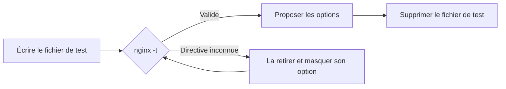

**Roastgate 0.3.0** est sortie : les sites statiques peuvent désormais afficher un listing de dossiers navigable, et Roastgate vérifie ce que votre nginx supporte vraiment avant de le proposer.

{/* truncate */}

## Des listings de dossiers navigables

Un site peut maintenant lister les fichiers de ses dossiers, avec leur taille et leur date, au lieu de répondre un 403 quand un dossier n'a pas d'`index.html`. Pratique pour une zone de téléchargement, un miroir ou un dossier d'artefacts de build.

Le listing utilise le module [fancyindex](https://github.com/aperezdc/ngx-fancyindex) de nginx. Activez **Browsable directory listing (fancyindex)** dans l'onglet **Essentials** de l'assistant de site, puis choisissez ses options :

- **Tri** : par nom, taille ou date, croissant ou décroissant, dossiers en premier ou non.
- **Affichage** : tailles exactes ou arrondies, heure locale ou UTC, votre propre format de date, le chemin au-dessus du listing.
- **Masquage** : les dotfiles, les liens symboliques, le lien vers le dossier parent, et une liste de noms à exclure.
- **Thème** : vos propres fichiers d'en-tête, de pied de page et CSS.

Comme toujours, l'onglet de prévisualisation montre exactement ce qui sera écrit. Un listing trié par date, le plus récent en premier :

```nginx
location / {
    try_files $uri $uri/ =404;
    fancyindex on;
    fancyindex_exact_size on;
    fancyindex_localtime off;
    fancyindex_show_path on;
    fancyindex_directories_first on;
    fancyindex_show_dotfiles off;
    fancyindex_hide_symlinks off;
    fancyindex_hide_parent_dir off;
    fancyindex_default_sort date_desc;
    fancyindex_time_format "%Y-%b-%d %H:%M";
}
```

Quelques garde-fous l'accompagnent :

- **Show dotfiles** est refusé tant que **Block TRACE and dotfiles** est activé, puisque cette protection refuse tout chemin qui commence par un point.
- Un thème rangé dans un dossier à point (comme `/.nginxy/`) passe à travers la protection des dotfiles : seulement les dossiers de vos fichiers d'en-tête, de pied de page et CSS, rien d'autre.
- Les chemins d'en-tête, de pied de page et CSS et le format de date sont validés avant d'arriver dans le fichier.

Les directives `fancyindex` existantes sont aussi relues quand vous [importez une configuration écrite à la main](/docs/roastgate/reverse-proxies-and-sites#importing-a-hand-written-config) dans l'assistant.

## Attentif aux modules de votre nginx

fancyindex ne fait pas partie de nginx lui-même. Roastgate lit désormais les modules que charge votre nginx (`nginx -T`), et ne propose le listing que si fancyindex en fait partie. S'il manque, l'interrupteur est grisé et l'assistant vous indique quoi installer :

```bash
sudo apt install libnginx-mod-http-fancyindex
sudo systemctl reload nginx
```

### Les builds d'un module diffèrent

Même quand le module est chargé, tous les builds ne connaissent pas toutes les directives. Le `libnginx-mod-http-fancyindex` 0.5.2 d'Ubuntu, par exemple, n'a pas `fancyindex_case_sensitive`, et nginx refuse un fichier entier qui nomme une directive qu'il ne connaît pas.

Deviner à partir d'un numéro de version n'est pas fiable, alors Roastgate interroge nginx lui-même. Il écrit une petite configuration de test dans `/etc/nginx/.roastgate-probe`, avec vos lignes `load_module` et les directives optionnelles, lance `nginx -t` dessus, puis la supprime aussitôt :



Votre configuration n'est jamais modifiée. Une option que nginx ne connaît pas est masquée dans l'assistant, et quand nginx ne peut pas du tout être interrogé, l'option reste disponible et `nginx -t` garde le dernier mot à l'enregistrement.

:::info
Les réponses de nginx sont gardées cinq minutes. Après avoir installé un autre build d'un module, attendez cinq minutes ou redémarrez Roastgate.
:::

La [documentation](/docs/roastgate/reverse-proxies-and-sites#directory-listing) détaille chaque option.

## Pour les contributeurs

Chaque fichier du code déclare désormais un seul type de premier niveau, une règle maintenant écrite dans le [guide de contribution](https://github.com/ByteRoast/Roastgate/blob/main/CONTRIBUTING.md). Rien ne change pour les utilisateurs, mais il est plus facile de s'y retrouver dans le code.

La documentation complète est aussi passée du README à [ce site](/docs/roastgate/) : le README garde l'essentiel et renvoie vers elle.

## Comment obtenir Roastgate 0.3.0 ?

### Mise à jour

Depuis le dossier qui contient `docker-compose.yml` :

```bash
docker compose pull
docker compose up -d
```

Le fichier compose n'a pas changé dans cette version : inutile de le télécharger à nouveau.

:::warning[Alpha]
Roastgate est toujours dans ses versions alpha `0.x`. Sauvegardez le volume `roastgate-data` avant de mettre à jour :

```bash
docker run --rm -v roastgate-data:/data -v "$PWD":/backup alpine tar czf /backup/roastgate-data.tgz -C /data .
```
:::

Pour rester sur cette version, utilisez le tag `0.3.0` au lieu de `latest` dans `docker-compose.yml`.

### Nouvelle installation

Suivez le [guide d'installation](/docs/roastgate/installation), ou l'article [Présentation de Roastgate 0.1.0](/blog/roastgate-0.1.0#how-can-i-get-roastgate) : les étapes sont les mêmes.

---

- [Roastgate sur GitHub](https://github.com/ByteRoast/Roastgate)
- [Release 0.3.0](https://github.com/ByteRoast/Roastgate/releases/tag/v0.3.0)
- [Signaler un problème](https://github.com/ByteRoast/Roastgate/issues)
