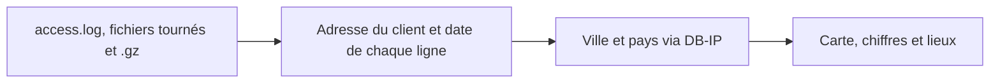

**Roastgate 0.4.0** est sortie : une nouvelle page **Traffic** montre d'où viennent les requêtes vers votre serveur, sur une carte du monde, et le résultat d'une action s'affiche désormais en toast, près de là où vous travaillez.

{/* truncate */}

## D'où vient votre trafic

La nouvelle page **Traffic**, dans le menu entre **Audit log** et **Settings**, lit les logs d'accès nginx et place chaque requête sur une carte du monde :



- **Une période** au choix : la dernière heure, 24 heures, 7 jours, 30 jours, ou depuis une date.
- **Des chiffres clés** : les requêtes, les adresses distinctes, les pays, et les requêtes qui n'ont pas pu être localisées (adresses privées, votre propre réseau Docker…).
- **La carte** : les pays colorés selon leur nombre de requêtes, sur une échelle logarithmique pour qu'un pays très actif n'efface pas les autres, et un point par ville. Survolez un pays ou une ville pour voir son drapeau et ses chiffres. Zoomez, déplacez-vous, et passez-la en plein écran.
- **Les lieux** : les dix premières villes avec une barre chacune, et un tableau paginé de toutes les villes.

Roastgate lit le fichier `access.log` courant, les fichiers tournés et les archives `.gz`, au format `combined` par défaut de nginx. Les fichiers modifiés pour la dernière fois avant la période choisie sont ignorés sans être ouverts : une courte période reste rapide même avec des mois d'archives. Rien n'est stocké : la page relit les logs à chaque fois.

### La base GeoIP

Les adresses sont localisées avec [DB-IP City Lite](https://db-ip.com/db/download/ip-to-city-lite), une base gratuite publiée chaque mois sous licence CC BY 4.0. Elle n'est pas fournie dans l'image. Pour que Roastgate la télécharge et la tienne à jour, définissez une variable dans `docker-compose.yml` :

```yaml
environment:
  ROASTGATE_GEOIP_AUTO_UPDATE: "true"
```

Cinq minutes après le démarrage, puis une fois par jour, Roastgate vérifie si une base mensuelle plus récente est sortie. Elle la télécharge (environ 60 Mo), vérifie que le fichier est valide, et la remplace sans redémarrage. Vous pouvez aussi copier le fichier à la main.

La [documentation](/docs/roastgate/traffic) détaille la page, les logs lus et la base.

:::caution[Derrière un CDN ou un proxy]
La carte montre l'adresse que nginx enregistre comme client. Derrière un CDN, c'est celle du CDN, sauf si le [module `real_ip`](https://nginx.org/en/docs/http/ngx_http_realip_module.html) de nginx est configuré.
:::

## Les résultats des actions en toasts

Enregistrer un fichier, activer un site, restaurer une sauvegarde ou lancer certbot affichait son résultat dans une alerte en haut de la page. Elle pouvait être loin du bouton cliqué, et elle restait là bien après avoir cessé d'être utile.

Un succès s'affiche désormais dans un court **toast** en haut de l'écran, qui nomme le fichier : `app.example.com.conf: Saved. nginx reloaded.` Il disparaît au bout de cinq secondes.

Ce que vous devez lire reste sur la page :

- un **échec ou un avertissement** reste affiché dans la page, avec la sortie de `nginx -t` ou de certbot, pour pouvoir la lire pendant que vous corrigez le problème ;
- **les alertes qui décrivent un état** (nginx injoignable, un dossier manquant, un fichier modifié à la main…) et les erreurs de formulaire ne changent pas.

Supprimer un fichier depuis son éditeur vous confirme aussi que c'est fait : le toast s'affiche sur la liste vers laquelle vous êtes renvoyé. Si nginx n'a pas pu être rechargé, ce toast est un avertissement qui reste jusqu'à ce que vous le fermiez.

## Pour les contributeurs

La suite end-to-end, qui pilote la vraie interface face à un vrai nginx, est passée d'un unique fichier JavaScript à des modules **TypeScript** exécutés directement par Node, avec des scripts **pnpm** pour construire les images et démarrer un conteneur neuf. Elle se trouve désormais dans `tests/Roastgate.E2E`, fait partie de la solution, et prend une capture d'écran de chaque section. Son [README](https://github.com/ByteRoast/Roastgate/blob/main/tests/Roastgate.E2E/README.md) explique comment la lancer et comment ajouter une vérification.

## Comment obtenir Roastgate 0.4.0 ?

### Mise à jour

Le fichier compose a changé dans cette version : il monte les logs nginx, en lecture seule, pour la page Traffic. Soit vous le [retéléchargez](/docs/roastgate/installation#install), ce qui écrase vos propres modifications, soit vous ajoutez le montage à votre copie :

```yaml
volumes:
  - /var/log/nginx:/var/log/nginx:ro
```

Puis, depuis le dossier qui contient `docker-compose.yml` :

```bash
docker compose pull
docker compose up -d
```

:::warning[Alpha]
Roastgate est toujours dans ses versions alpha `0.x`. Sauvegardez le volume `roastgate-data` avant de mettre à jour :

```bash
docker run --rm -v roastgate-data:/data -v "$PWD":/backup alpine tar czf /backup/roastgate-data.tgz -C /data .
```

:::

Pour rester sur cette version, utilisez le tag `0.4.0` au lieu de `latest` dans `docker-compose.yml`.

### Nouvelle installation

Suivez le [guide d'installation](/docs/roastgate/installation), ou l'article [Présentation de Roastgate 0.1.0](/blog/roastgate-0.1.0#how-can-i-get-roastgate) : les étapes sont les mêmes.

---

- [Roastgate sur GitHub](https://github.com/ByteRoast/Roastgate)
- [Release 0.4.0](https://github.com/ByteRoast/Roastgate/releases/tag/v0.4.0)
- [Signaler un problème](https://github.com/ByteRoast/Roastgate/issues)
