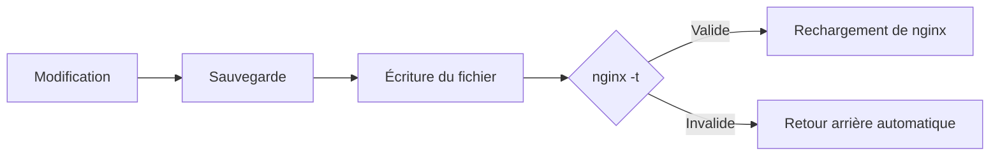

# Roastgate

Roastgate est une interface web qui pilote le **nginx installé sur votre serveur**. Elle tourne dans un conteneur Docker à côté de nginx et gère :

- **Les reverse proxies** : rediriger un domaine vers une application ou un conteneur.
- **Les sites** : servir des fichiers statiques (un site web, une single page application).
- **Les listes blanches d'IP** : restreindre un proxy ou un site à certaines adresses.
- **Les certificats Let's Encrypt** : les obtenir, les renouveler et les supprimer.

Roastgate n'utilise jamais de format propre : elle lit et écrit les fichiers nginx classiques. Votre `/etc/nginx` reste la source de vérité, vous pouvez donc continuer à modifier les fichiers à la main, et arrêter d'utiliser Roastgate à tout moment sans rien perdre.

:::warning[Alpha]
Roastgate en est à ses versions alpha `0.x` : les réglages, le schéma de la base de données et le comportement peuvent changer d'une version à l'autre. [Sauvegardez le volume de données](./maintenance.md#back-up-the-data) avant chaque mise à jour.
:::

## Ce qu'elle gère

| Élément                  | Contenu             | Emplacement                  | Actif lorsque                                    |
|--------------------------|---------------------|------------------------------|--------------------------------------------------|
| Reverse proxies          | blocs `server`      | `conf.d/<name>.conf`         | le fichier se termine par `.conf` (et non `.conf.disabled`) |
| Sites                    | blocs `server`      | `sites-available/<name>`     | un lien symbolique existe dans `sites-enabled/`  |
| Listes blanches          | lignes `allow <ip>;`| `whitelists/<name>.conf`     | une configuration l'inclut avec `include`        |
| Certificats              | Let's Encrypt       | `/etc/letsencrypt`           | une configuration y fait référence               |

Les arborescences Debian et Ubuntu (`conf.d/`, `sites-available/`, `sites-enabled/`) sont prises en charge.

## Un cycle de modification sûr

Chaque modification faite depuis Roastgate (enregistrement, activation, désactivation, suppression, restauration) suit le même cycle :

- L'ancien contenu est conservé en tant que **sauvegarde** (les 30 plus récentes par fichier), voir [Sauvegardes](./backups-and-audit-log.md).
- Les écritures sont **atomiques** (fichier temporaire, puis renommage) et conservent les permissions d'origine du fichier.
- Si `nginx -t` échoue, la modification est **annulée** et l'erreur nginx est affichée. nginx continue de tourner avec la configuration précédente.
- Si `nginx -t` échouait déjà pour une raison sans rapport avec votre modification, celle-ci est également annulée, et Roastgate vous le signale.

## Par où commencer

1. [Installez Roastgate](./installation.md) sur votre serveur.
2. Lancez la [première configuration](./first-start.md).
3. Créez votre premier [reverse proxy ou site](./reverse-proxies-and-sites.md).
4. Protégez votre compte avec l'[authentification à deux facteurs ou une passkey](./account-security.md).
